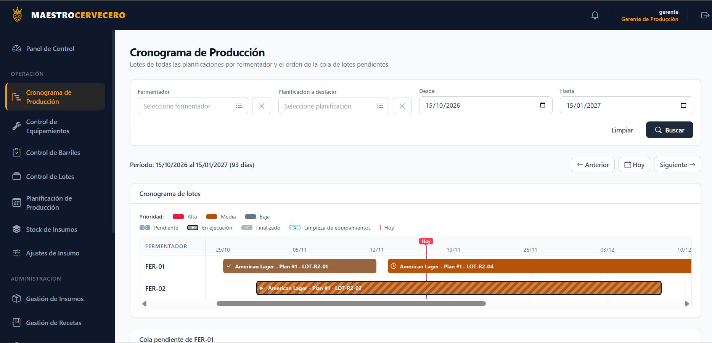
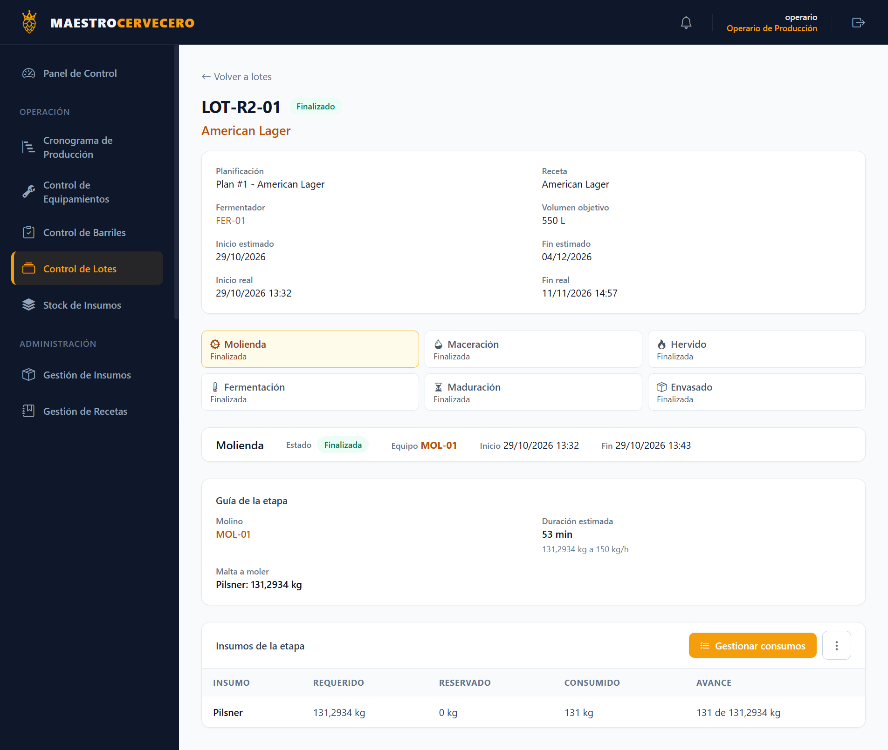

<p align="center">
  
</p>

<h1 align="center">Maestro Cervecero</h1>

<p align="center">
  Sistema web para gestionar la producción de cerveza artesanal, desde la receta y la compra de insumos hasta el envasado y el control de barriles.
</p>

<p align="center">
  <a href="https://github.com/HeikyuDev/MaestroCervecero/actions/workflows/ci.yml"></a>
  
  
  
</p>

## De qué trata

Maestro Cervecero es una aplicación monolítica (Spring Boot, MVC y Thymeleaf) que reemplaza las planillas de una cervecería artesanal por un único sistema. Permite planificar y ejecutar lotes de producción, controlar el stock de insumos, administrar el equipamiento y los barriles, y consultar estadísticas.

Fue desarrollado con una metodología basada en el Proceso Unificado.

Cada usuario tiene uno de seis roles, con permisos definidos en código:

| Rol | Responsabilidad |
|---|---|
| Gerente de Producción | Recetas, planificación, lotes, insumos y equipamiento |
| Operario de Producción | Ejecución de las etapas del lote |
| Gerente de Compras | Proveedores y órdenes de compra |
| Encargado de Depósito | Ingresos y ajustes de insumos |
| Encargado de Distribución | Clientes, despachos y control de barriles |
| Administrador | Usuarios, auditoría y configuración |

## Capturas



*Cronograma de producción: diagrama de Gantt donde cada carril es un fermentador*



*Panel operativo de gestión de lotes*

## Funcionalidades principales

| Módulo | Descripción |
|---|---|
| Lotes | Registro, inicio y seguimiento por etapa, consumo de insumos y envasado |
| Recetas | Recetas versionadas con maltas, lúpulos y levaduras, y escalado por volumen |
| Planificación de producción | Planes de producción y cronograma de fermentadores |
| Insumos y stock | Maestros de insumos, ingresos, ajustes y reservas |
| Compras | Proveedores y órdenes de compra |
| Equipamiento | Equipos, limpiezas, fallas y mantenimientos |
| Barriles | Control de barriles: envasado, despacho, devolución, limpieza, fallas y mantenimiento |
| Clientes y ubicaciones | Maestros comerciales y de localización |
| Costos adicionales | Costos directos adicionales |
| Estadísticas | Informes por pestañas con exportación a PDF |
| Auditoría y usuarios | Registro de operaciones y administración de usuarios |
| Paneles de control | Pantalla de inicio específica para cada rol |

## Tecnologías

| Área | Tecnología |
|---|---|
| Lenguaje | Java 21 |
| Framework | Spring Boot 4.1.0 (Web MVC, Data JPA, Security, Validation, Actuator) |
| Vistas | Thymeleaf con Thymeleaf Extras Spring Security |
| Base de datos | PostgreSQL con Flyway para las migraciones |
| PDF | OpenHTMLtoPDF (PDFBox y soporte SVG) |
| Estilos | Tailwind CSS 3.4, compilado y versionado en `static/css` |
| Utilidades | Lombok |
| Construcción | Maven (wrapper incluido) |
| Integración continua | GitHub Actions |

## Cómo ejecutar

### Inicio rápido

1. Instale JDK 21 y PostgreSQL (el CI usa la versión 16).
2. Cree una base de datos vacía llamada `maestrocervecero_dev` y configure el usuario y la contraseña de PostgreSQL en el archivo de propiedades del perfil `dev` (`src/main/resources`).

3. Inicie la aplicación desde la raíz del proyecto:

   ```bash
   ./mvnw spring-boot:run          # Linux y macOS
   ```

   ```powershell
   .\mvnw.cmd spring-boot:run      # Windows
   ```

4. Abra <http://localhost:7777>. El usuario administrador inicial lo crea la clase `UserDataLoader` al arrancar.

### Detalles

**Perfiles.** Sin configuración se usa `dev`. El perfil se elige con `spring.profiles.active` o con la variable `SPRING_PROFILES_ACTIVE`.

| Perfil | Base de datos | SQL en consola |
|---|---|---|
| `dev` (por defecto) | `maestrocervecero_dev` | Sí |
| `prod` | `maestrocervecero` | No |
| `test` | `maestrocervecero_test` (reservado para tests de integración) | No |

Para producción: `./mvnw spring-boot:run "-Dspring-boot.run.profiles=prod"`. En ese perfil se pueden reemplazar la conexión con las variables `SPRING_DATASOURCE_URL`, `SPRING_DATASOURCE_USERNAME` y `SPRING_DATASOURCE_PASSWORD`.

Detrás de un proxy que termina el HTTPS, producción necesita `server.forward-headers-strategy=framework` (por ejemplo, con la variable `SERVER_FORWARD_HEADERS_STRATEGY=framework`) para que la aplicación reconozca el HTTPS original y marque `Secure` la cookie CSRF de la pantalla pública de cotización, y `APP_URL_BASE` con la dirección pública en `https://`, que se usa en los enlaces de los correos (restablecer la contraseña y cotizar).

**Esquema.** Flyway aplica al arrancar las migraciones pendientes de `src/main/resources/db/migration` (`V1` esquema, `V2` datos iniciales, hasta `V31`). Luego Hibernate (`ddl-auto=validate`) comprueba que las entidades coincidan con las tablas. No cree tablas a mano: una base con tablas y sin historial de Flyway no se adopta y debe recrearse.

**Tests.**

```bash
./mvnw test
```

Los tests son unitarios y no usan base de datos. El CI (`.github/workflows/ci.yml`) ejecuta esta misma instrucción en cada push a `main`.

**Estilos.** Maven no compila el CSS. Solo si modifica clases de Tailwind, reconstruya `tailwind.css` como se indica en [EstilosLocales.md](docs/Tecnico/EstilosLocales.md).

## Arquitectura

Monolito en capas bajo `src/main/java/com/github/heikyudev/maestrocervecero`:

| Paquete | Contenido |
|---|---|
| `presentation` | Controllers, FormDTOs, advices y vistas |
| `service` | Interfaces, implementaciones, ResponseDTOs, excepciones y aspectos |
| `persistence` | Entidades, enums y repositorios Spring Data |
| `configuration` | Seguridad, auditoría, web y carga del usuario inicial |
| `util` | Mappers, formatters, validaciones y utilidades comunes |

El esquema lo gestiona solo Flyway y Hibernate únicamente lo valida. Consulte el [diagrama de clases](docs/MetodologiaUP/Dise%C3%B1o/DiagramaDeClases/class_diagram.md) (Mermaid) y la [documentación de base de datos](docs/Tecnico/BaseDeDatos.md).

## Documentación

| Documento | Contenido |
|---|---|
| [Requerimientos (PDF)](docs/MetodologiaUP/Requerimientos/TF%20-%202026%20-%20Requerimientos%20-%20Theisen%20Nahuel.docx.pdf) | Entregable de requerimientos |
| [Reglas de dominio](docs/MetodologiaUP/Requerimientos/Dominio/CronogramaDeProduccion.md) | Cronograma, estimación de etapas y escalado de insumos |
| [Análisis (PDF)](docs/MetodologiaUP/Analisis/TF%20-%202026%20-%20An%C3%A1lisis%20-%20Theisen%20Nahuel.docx.pdf) | Entregable de análisis |
| [DSS](docs/MetodologiaUP/Analisis/DSS) | Diagramas de secuencia del sistema, por módulo (imágenes) |
| [Diseño (PDF)](docs/MetodologiaUP/Dise%C3%B1o/TF%20-%202026%20-%20Dise%C3%B1o%20-%20Theisen%20Nahuel.docx.pdf) | Entregable de diseño |
| [DSD](docs/MetodologiaUP/Dise%C3%B1o/DSD) | Diagramas de secuencia de diseño por operación |
| [Diseño de pantallas](docs/MetodologiaUP/Dise%C3%B1o/Dise%C3%B1oDePantallas) | Pantallas por módulo y paneles por rol |
| [Diagrama de clases](docs/MetodologiaUP/Dise%C3%B1o/DiagramaDeClases/class_diagram.md) | Diagrama de clases en Mermaid |
| [Técnico](docs/Tecnico) | Base de datos, estándares de interfaz y estilos locales |
| [Casos de prueba](docs/MetodologiaUP/Testing/casos_de_prueba) | Casos por capa (services y controllers) y por módulo |

## Metodología de desarrollo

El proyecto sigue un enfoque basado en el Proceso Unificado (carpeta `docs/MetodologiaUP`), con los entregables de Requerimientos, Análisis y Diseño antes de la implementación. Cada módulo se construye en este orden:

1. DTOs
2. Mapper
3. Interfaz del service
4. Validaciones y postcondiciones
5. Implementación
6. Documento de casos de prueba
7. Tests

## Autor

Theisen Nahuel
