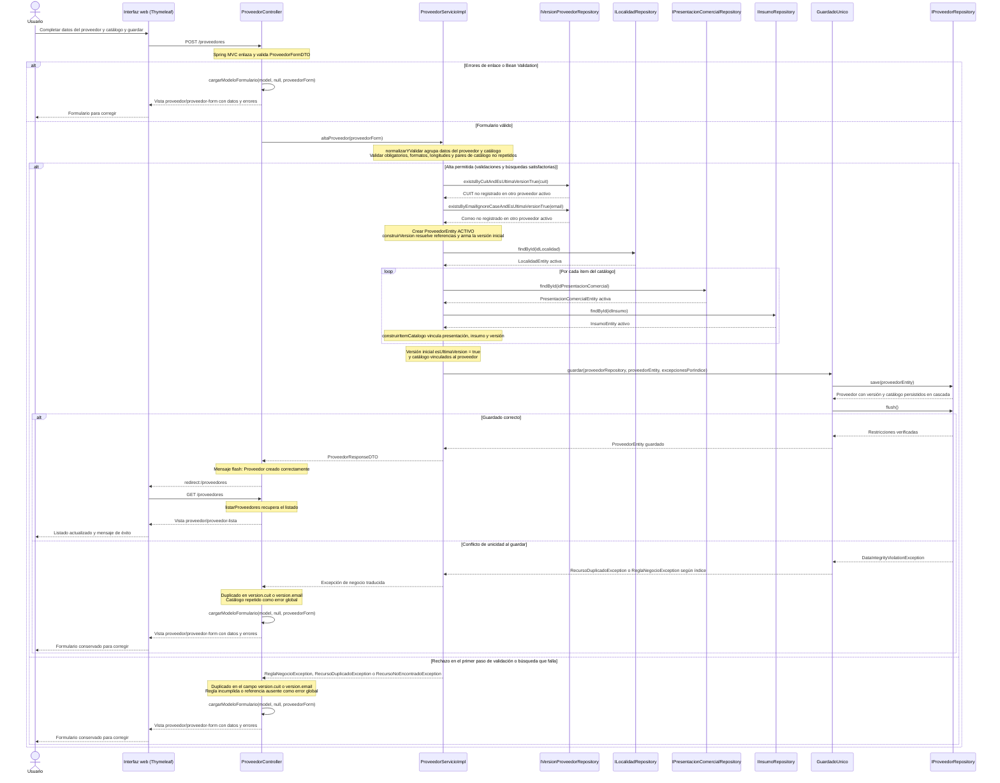

# Diagrama de secuencia de diseño: dar de alta un proveedor

El diagrama muestra cómo `ProveedorController.altaProveedor` y `ProveedorServicioImpl.altaProveedor` registran un proveedor activo con su primera versión y catálogo. Parte del formulario ya abierto, con un usuario autorizado como `GERENTE_DE_COMPRAS`.

## Participantes y abstracción

- **Interfaz web y ProveedorController:** representan `proveedor/proveedor-form.html`, la petición HTTP y el listado `proveedor/proveedor-lista.html`. El éxito utiliza Post-Redirect-Get. Los errores vuelven a renderizar el formulario en la misma petición, conservando los datos y filas del catálogo.
- **ProveedorServicioImpl e IVersionProveedorRepository:** coordinan el alta transaccional y comprueban la unicidad del CUIT normalizado y del correo, sin distinguir mayúsculas en este último, entre versiones vigentes de proveedores activos. La razón social no es única y el teléfono es opcional.
- **ILocalidadRepository, IPresentacionComercialRepository e IInsumoRepository:** resuelven las referencias activas de la versión y de cada ítem. El catálogo debe tener al menos un ítem, respetar el máximo técnico y no repetir la combinación de insumo y presentación comercial.
- **GuardadoUnico e IProveedorRepository:** guardan el proveedor, la versión inicial y su catálogo mediante cascada. `save` y `flush` se conservan visibles para explicar la traducción de conflictos concurrentes de unicidad dentro del servicio. El helper traduce los índices de CUIT y correo a duplicados y el de ítem repetido a una regla de negocio.

El proveedor funciona como contenedor estable: sus datos comerciales, contacto, localidad y catálogo pertenecen a `VersionProveedorEntity`, marcada inicialmente como vigente. Las entidades se muestran como datos, sin líneas de vida propias porque no coordinan las colaboraciones del alta.

La alternativa permitida presenta el recorrido satisfactorio hasta el guardado. Un dato inválido, un duplicado o una referencia inexistente interrumpen el primer paso que falle, sin ejecutar los siguientes. Un conflicto concurrente puede ocurrir aunque las consultas previas de unicidad hayan pasado. La transacción revierte las escrituras si falla el alta. No se agrega recuperación para errores técnicos que el controlador no captura.

`rechazarDuplicado` asocia el error a `version.cuit` o `version.email` cuando la excepción indica el campo, y lo registra como error global si no lo indica. Las reglas de negocio y las referencias ausentes se muestran en el resumen global. `cargarModeloFormulario` encapsula las consultas de presentación que recuperan la ubicación y los nombres de los insumos y presentaciones comerciales seleccionados.

La normalización de CUIT, correo y textos, las validaciones internas, la construcción de entidades y la conversión a DTO se resumen. Se omiten getters, setters, buscadores, apertura inicial del formulario e infraestructura transversal de seguridad y auditoría. El diagrama cubre el alta y no la creación de versiones posteriores al modificar un proveedor.

## Código de referencia

- [ProveedorController.java](../../../../src/main/java/com/github/heikyudev/maestrocervecero/presentation/controller/proveedor/ProveedorController.java): `altaProveedor`, `rechazarDuplicado`, `cargarModeloFormulario` y listado.
- [ProveedorServicioImpl.java](../../../../src/main/java/com/github/heikyudev/maestrocervecero/service/implementation/proveedor/ProveedorServicioImpl.java): `altaProveedor`, `normalizarYValidar`, `construirVersion` y `construirItemCatalogo`.
- [IVersionProveedorRepository.java](../../../../src/main/java/com/github/heikyudev/maestrocervecero/persistence/repository/proveedor/IVersionProveedorRepository.java) e [IProveedorRepository.java](../../../../src/main/java/com/github/heikyudev/maestrocervecero/persistence/repository/proveedor/IProveedorRepository.java): unicidad y persistencia.
- [ILocalidadRepository.java](../../../../src/main/java/com/github/heikyudev/maestrocervecero/persistence/repository/ubicacion/ILocalidadRepository.java), [IPresentacionComercialRepository.java](../../../../src/main/java/com/github/heikyudev/maestrocervecero/persistence/repository/proveedor/IPresentacionComercialRepository.java) e [IInsumoRepository.java](../../../../src/main/java/com/github/heikyudev/maestrocervecero/persistence/repository/insumo/IInsumoRepository.java): referencias de localidad y catálogo.
- [GuardadoUnico.java](../../../../src/main/java/com/github/heikyudev/maestrocervecero/util/persistencia/GuardadoUnico.java): persistencia y traducción de índices únicos.
