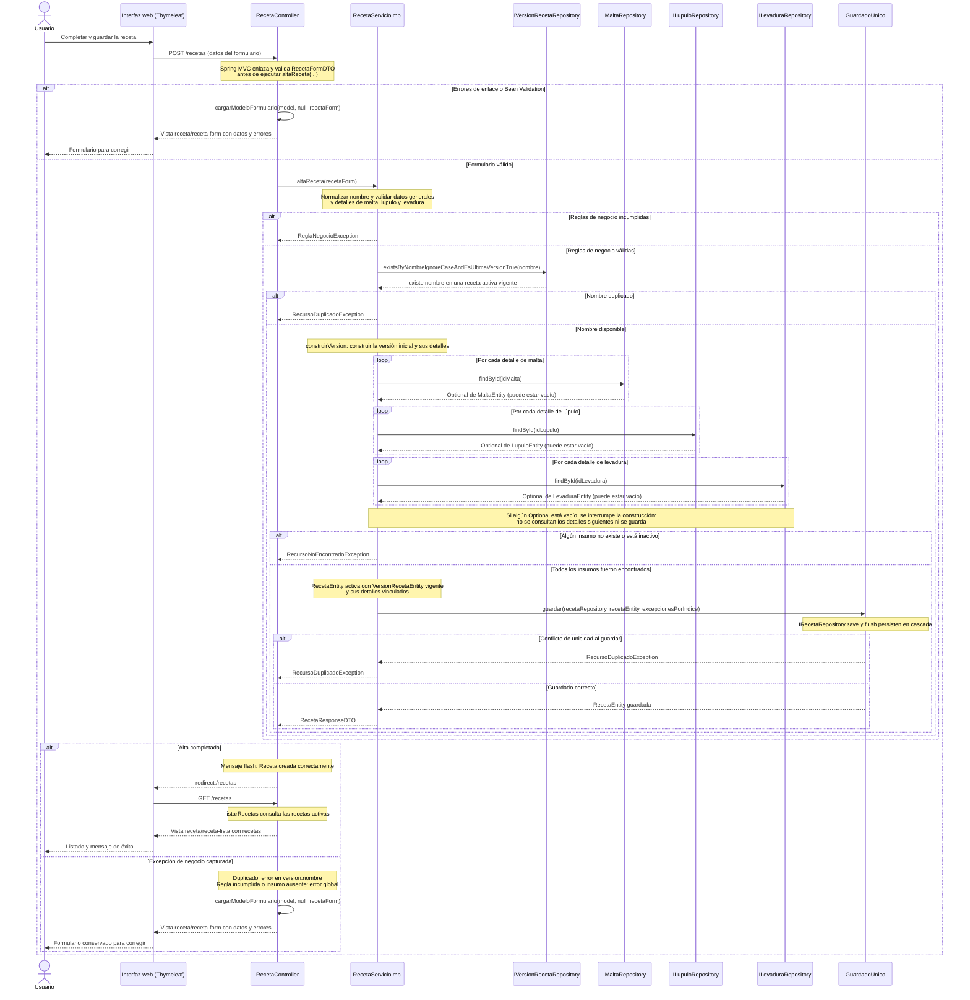

# Diagrama de secuencia de diseño: alta de receta

El diagrama muestra cómo `RecetaController.altaReceta` y `RecetaServicioImpl.altaReceta` colaboran para registrar una receta activa con su primera versión y sus ingredientes. Parte del envío del formulario ya abierto, con un usuario autorizado como `GERENTE_DE_PRODUCCION`.

## Participantes y abstracción

- **Interfaz web:** representación conceptual del navegador y las plantillas reales `receta/receta-form.html` y `receta/receta-lista.html`. Las flechas HTTP representan peticiones; los nombres de vistas y la redirección representan resultados MVC, no llamadas Java a una plantilla.
- **RecetaController:** recibe el formulario validado, delega el alta y decide entre volver al formulario o aplicar Post-Redirect-Get.
- **RecetaServicioImpl:** valida las reglas productivas, verifica el nombre y construye la receta con su versión inicial. Las validaciones internas se agrupan en una nota; `construirVersion` sí es un método real.
- **Repositorios:** `IVersionRecetaRepository` comprueba la unicidad del nombre; los tres repositorios de ingredientes recuperan insumos activos; `IRecetaRepository` persiste y consulta recetas. Las entidades y DTO se muestran como datos, sin líneas de vida propias, porque no coordinan este flujo.
- **GuardadoUnico:** encapsula la persistencia mediante `IRecetaRepository.save` y `flush`, y la traducción de conflictos de unicidad por altas simultáneas. La receta, su versión y sus detalles se persisten mediante `CascadeType.ALL` dentro del alta transaccional.

Los bucles resumen las consultas por ingrediente en su orden real: maltas, lúpulos y levaduras. La ausencia de un insumo interrumpe inmediatamente la construcción; la alternativa posterior resume ese resultado, no implica que se sigan ejecutando los bucles tras el error.

Se omiten getters, setters, builders, conversión a DTO y formateo de densidades. `cargarModeloFormulario` también recupera los nombres de los insumos seleccionados mediante los servicios de insumos (`buscarPorId`); esas consultas de presentación se encapsulan para no duplicar el flujo principal. Se omiten los buscadores modales y la apertura inicial del formulario, que son peticiones independientes, así como la infraestructura transversal de seguridad y auditoría (`@AuditableAction`). El diagrama cubre las excepciones de negocio capturadas por este controlador; no agrega una recuperación para fallos técnicos no capturados.

## Código de referencia

- [RecetaController.java](../../../../src/main/java/com/github/heikyudev/maestrocervecero/presentation/controller/receta/RecetaController.java): `altaReceta`, `cargarModeloFormulario` y `listarRecetas`.
- [RecetaServicioImpl.java](../../../../src/main/java/com/github/heikyudev/maestrocervecero/service/implementation/receta/RecetaServicioImpl.java): `altaReceta`, validaciones y construcción de los detalles.
- [GuardadoUnico.java](../../../../src/main/java/com/github/heikyudev/maestrocervecero/util/persistencia/GuardadoUnico.java): persistencia y traducción de restricciones únicas.
- [RecetaEntity.java](../../../../src/main/java/com/github/heikyudev/maestrocervecero/persistence/entity/receta/RecetaEntity.java) y [VersionRecetaEntity.java](../../../../src/main/java/com/github/heikyudev/maestrocervecero/persistence/entity/receta/VersionRecetaEntity.java): relaciones y cascadas.
