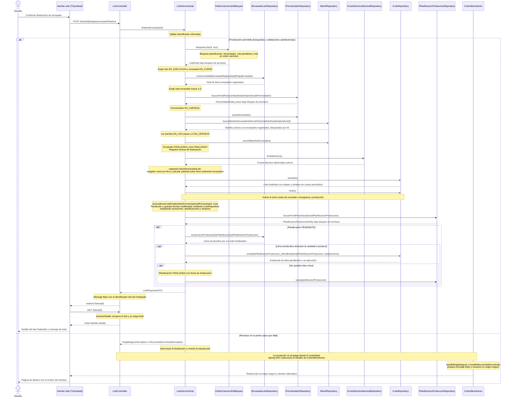

# Diagrama de secuencia de diseño: finalizar envasado

El diagrama muestra cómo `LoteController.finalizarEnvasado` y `LoteServicioImpl.finalizarEnvasado` cierran el proceso productivo: finalizan el lote, actualizan fermentador y barriles, registran costos históricos y revisan el cronograma y la planificación. Parte del detalle del lote ya abierto, con un usuario autorizado mediante `LOTE_FINALIZAR_ENVASADO`.

## Participantes y abstracción

- **Interfaz web y LoteController:** representan la confirmación desde `lote/lote-detalle.html`, la petición HTTP y el retorno mediante Post-Redirect-Get al detalle con un mensaje de éxito.
- **LoteServicioImpl y OrdenCanonicoDeBloqueo:** coordinan la transacción y los bloqueos. El parámetro `true` incluye la planificación antes de bloquear fermentador, cola y lote, porque esta operación puede finalizarla.
- **IEnvasadoLoteRepository:** aporta los litros efectivamente envasados del lote y los litros producidos de la planificación. Se exige producción positiva, no alcanzar el volumen objetivo del lote.
- **IFermentadorRepository e IBarrilRepository:** dejan el fermentador en `EN_LIMPIEZA` y los barriles utilizados que están `EN_USO` en `CON_CERVEZA`. Los barriles se recuperan bajo bloqueo por ID ascendente; no se inventa una liberación general de todos los equipos.
- **ICostoDirectoAdicionalRepository e ILoteRepository:** aportan los costos activos y persisten el cierre. Cada `DetalleCostoDirectoEntity` conserva el costo por litro aplicado y su subtotal sobre el total realmente envasado; los detalles y las etapas se guardan con el lote mediante cascada.
- **IPlanificacionProduccionRepository:** participa en `finalizarPlanificacionSiCorresponde`. La planificación solo pasa a `FINALIZADA` si sigue `PENDIENTE`, alcanzó su cantidad a producir y no tiene lotes pendientes ni en ejecución. Si alguna condición no se cumple, el lote igualmente queda finalizado.
- **ControllerAdvices:** maneja los rechazos propagados por el controlador. Una regla incumplida genera una advertencia y un recurso ausente un error; resuelve una redirección segura a partir del origen del pedido y sus alternativas.

El fragmento permitido resume el recorrido satisfactorio. La alternativa representa una interrupción en el primer paso que falle: identificador no informado, lote o etapa incorrectos, ausencia de litros envasados o fechas inválidas al reencadenar generan `ReglaNegocioException`; los recursos no recuperables generan `RecursoNoEncontradoException`. Los pasos posteriores no se ejecutan y la transacción revierte las escrituras previas, incluso si ya hubo `flush`.

El reencadenado se encapsula en una nota para evitar expandir sus consultas internas a `ILoteRepository`. Conserva orden y duraciones de los lotes pendientes, respeta sus planificaciones y deja como mínimo el día siguiente al actual para el próximo inicio por limpieza. El `flush` previo hace que las consultas posteriores ya observen el lote finalizado dentro de la transacción.

Envasado es la última etapa: no se utiliza `avanzarEtapa`, no se valida porcentaje mínimo de consumo y no se liberan reservas de insumos. Este método cierra la etapa usando envasados previamente registrados; no registra nuevas cargas en barriles. Se omiten getters, setters, conversiones a DTO, cálculos aritméticos, consultas de presentación e infraestructura transversal de seguridad y auditoría. Las entidades se representan como datos y los errores técnicos quedan fuera del diagrama.

## Código de referencia

- [LoteController.java](../../../../src/main/java/com/github/heikyudev/maestrocervecero/presentation/controller/lote/LoteController.java): `finalizarEnvasado`, `redirigirAlDetalle` y `mostrarDetalle`.
- [LoteServicioImpl.java](../../../../src/main/java/com/github/heikyudev/maestrocervecero/service/implementation/lote/LoteServicioImpl.java): `finalizarEnvasado`, registro de costos, reencadenado y finalización condicional de la planificación.
- [OrdenCanonicoDeBloqueo.java](../../../../src/main/java/com/github/heikyudev/maestrocervecero/service/implementation/lote/OrdenCanonicoDeBloqueo.java): `bloquearLote`.
- [IEnvasadoLoteRepository.java](../../../../src/main/java/com/github/heikyudev/maestrocervecero/persistence/repository/lote/IEnvasadoLoteRepository.java), [IFermentadorRepository.java](../../../../src/main/java/com/github/heikyudev/maestrocervecero/persistence/repository/equipamiento/IFermentadorRepository.java) e [IBarrilRepository.java](../../../../src/main/java/com/github/heikyudev/maestrocervecero/persistence/repository/barril/IBarrilRepository.java): litros envasados y equipos/barriles.
- [ICostoDirectoAdicionalRepository.java](../../../../src/main/java/com/github/heikyudev/maestrocervecero/persistence/repository/costo_adicional/ICostoDirectoAdicionalRepository.java), [ILoteRepository.java](../../../../src/main/java/com/github/heikyudev/maestrocervecero/persistence/repository/lote/ILoteRepository.java) e [IPlanificacionProduccionRepository.java](../../../../src/main/java/com/github/heikyudev/maestrocervecero/persistence/repository/planificacion_produccion/IPlanificacionProduccionRepository.java): costos, persistencia y cierre de la planificación.
- [ControllerAdvices.java](../../../../src/main/java/com/github/heikyudev/maestrocervecero/presentation/advice/ControllerAdvices.java): manejo global de rechazos y redirección segura.
