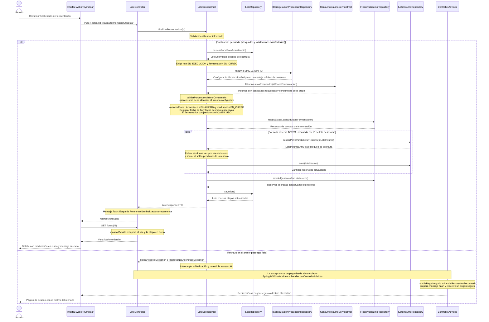

# Diagrama de secuencia de diseño: finalizar fermentación

El diagrama muestra cómo `LoteController.finalizarFermentacion` y `LoteServicioImpl.finalizarFermentacion` verifican el consumo mínimo de la etapa, inician la maduración y liberan las reservas sobrantes de fermentación. Parte del detalle del lote ya abierto, con un usuario autorizado mediante `LOTE_FINALIZAR_FERMENTACION`.

## Participantes y abstracción

- **Interfaz web y LoteController:** representan la confirmación desde `lote/lote-detalle.html`, la petición HTTP y el retorno mediante Post-Redirect-Get. `volverDeFinalizarEtapa` prepara el mensaje y redirige al detalle sin fijar pestaña; este abre la etapa en curso.
- **LoteServicioImpl e ILoteRepository:** coordinan la transacción y bloquean el lote para serializar la finalización con consumos, cancelaciones y solicitudes repetidas. El lote permanece `EN_EJECUCION`; fermentación pasa a `FINALIZADA` y maduración a `EN_CURSO`, con sus fechas respectivas.
- **IConfiguracionProduccionRepository y ConsumoInsumoServicioImpl:** aportan el mínimo configurado y las cantidades requeridas y consumidas. Se exige el mínimo por cada insumo, no sobre un porcentaje global. Con mínimo cero no se exige consumo; un rechazo informa todos los insumos insuficientes.
- **IReservaInsumoRepository e ILoteInsumoRepository:** liberan únicamente los saldos de reservas activas de fermentación y actualizan las cantidades reservadas del stock, conservando el historial y las reservas de otras etapas.
- **ControllerAdvices:** maneja los rechazos propagados por el controlador. Una regla incumplida genera una advertencia y un recurso ausente un error; resuelve una redirección segura a partir del origen del pedido y sus alternativas.

El fragmento permitido resume el recorrido satisfactorio. La alternativa representa una interrupción en el primer paso que falle: identificador no informado, lote o etapa incorrectos y consumo insuficiente generan `ReglaNegocioException`; los recursos no recuperables generan `RecursoNoEncontradoException`. No se ejecutan los pasos posteriores al fallo y la transacción revierte las escrituras previas.

El fermentador es compartido por fermentación, maduración y envasado: continúa `EN_USO`, sin consultas ni escrituras a un repositorio de equipos en esta transición. El método real `avanzarEtapa` se resume en una nota. Las entidades se representan como datos y las etapas se actualizan mediante la cascada del lote.

`filtrarInsumosRequeridos` encapsula la recuperación de etapa, consumos registrados, saldos reservados y requerimientos calculados por `EscaladoInsumoServicioImpl`. La liberación resume la relectura de stock mediante `EntityManager.refresh`, que evita usar cantidades cargadas antes del bloqueo. Finalizar verifica el consumo existente y libera el remanente reservado; no registra consumo automáticamente.

Se omiten getters, setters, conversiones a DTO, redondeos, consultas de presentación del detalle e infraestructura transversal de seguridad y auditoría. Este flujo no reencadena el cronograma del fermentador. Los errores técnicos quedan fuera del diagrama.

## Código de referencia

- [LoteController.java](../../../../src/main/java/com/github/heikyudev/maestrocervecero/presentation/controller/lote/LoteController.java): `finalizarFermentacion`, `volverDeFinalizarEtapa` y `mostrarDetalle`.
- [LoteServicioImpl.java](../../../../src/main/java/com/github/heikyudev/maestrocervecero/service/implementation/lote/LoteServicioImpl.java): `finalizarFermentacion`, validación del mínimo, avance y liberación de reservas.
- [ConsumoInsumoServicioImpl.java](../../../../src/main/java/com/github/heikyudev/maestrocervecero/service/implementation/lote/ConsumoInsumoServicioImpl.java): `filtrarInsumosRequeridos`.
- [ILoteRepository.java](../../../../src/main/java/com/github/heikyudev/maestrocervecero/persistence/repository/lote/ILoteRepository.java), [IReservaInsumoRepository.java](../../../../src/main/java/com/github/heikyudev/maestrocervecero/persistence/repository/lote/IReservaInsumoRepository.java) e [ILoteInsumoRepository.java](../../../../src/main/java/com/github/heikyudev/maestrocervecero/persistence/repository/ingreso_insumo/ILoteInsumoRepository.java): bloqueo y persistencia.
- [ControllerAdvices.java](../../../../src/main/java/com/github/heikyudev/maestrocervecero/presentation/advice/ControllerAdvices.java): manejo global de rechazos y redirección segura.
