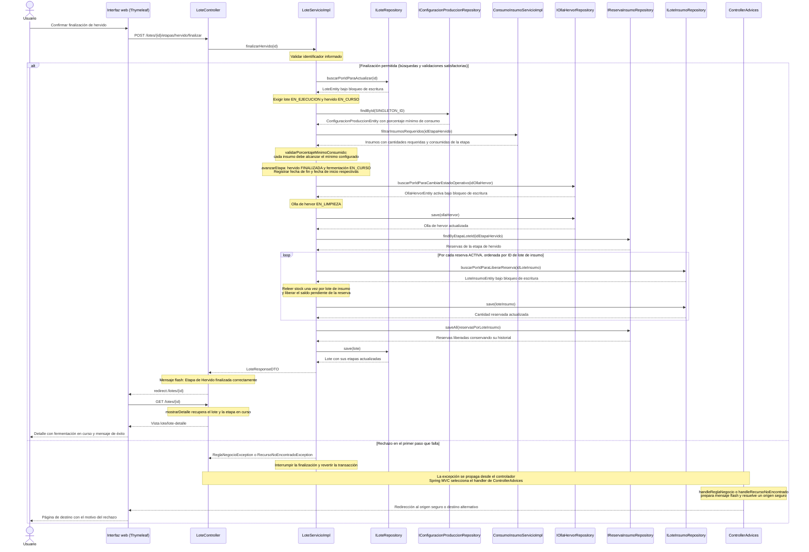

# Diagrama de secuencia de diseño: finalizar hervido

El diagrama muestra cómo `LoteController.finalizarHervido` y `LoteServicioImpl.finalizarHervido` verifican el consumo mínimo del hervido, inician la fermentación, dejan la olla en limpieza y liberan las reservas sobrantes de la etapa. Parte del detalle del lote ya abierto, con un usuario autorizado mediante `LOTE_FINALIZAR_HERVIDO`.

## Participantes y abstracción

- **Interfaz web y LoteController:** representan la confirmación desde `lote/lote-detalle.html`, la petición HTTP y el retorno mediante Post-Redirect-Get. `volverDeFinalizarEtapa` prepara el mensaje y redirige al detalle sin fijar pestaña; este abre la etapa en curso.
- **LoteServicioImpl e ILoteRepository:** coordinan la transacción y bloquean el lote para serializar la finalización con consumos, cancelaciones y solicitudes repetidas. El lote permanece `EN_EJECUCION`; cambian las etapas de hervido y fermentación, persistidas con el lote.
- **IConfiguracionProduccionRepository y ConsumoInsumoServicioImpl:** aportan el mínimo configurado y las cantidades requeridas y consumidas. La condición se evalúa por insumo, no sobre un porcentaje global. Un mínimo de cero no exige consumo; un rechazo informa todos los insumos insuficientes.
- **IOllaHervorRepository:** recupera la olla activa bajo bloqueo y la guarda en `EN_LIMPIEZA`. El fermentador conserva su estado operativo; este método inicia su etapa de fermentación sin volver a ocupar el equipo.
- **IReservaInsumoRepository e ILoteInsumoRepository:** liberan solo el saldo de las reservas activas de hervido y actualizan las cantidades reservadas del stock. Conservan el historial y las reservas de las otras etapas.
- **ControllerAdvices:** maneja los rechazos propagados por el controlador. Una regla incumplida genera una advertencia y un recurso ausente un error; resuelve una redirección segura a partir del origen del pedido y sus alternativas.

El fragmento permitido resume el recorrido satisfactorio. La alternativa representa una interrupción en el primer paso que falle: identificador no informado, lote o etapa incorrectos y consumo insuficiente generan `ReglaNegocioException`; los recursos no recuperables generan `RecursoNoEncontradoException`. No se ejecutan los pasos posteriores al fallo y la transacción revierte las escrituras previas.

`filtrarInsumosRequeridos` encapsula la recuperación de etapa, consumos registrados, saldos reservados y requerimientos calculados por `EscaladoInsumoServicioImpl`. Las transiciones del método real `avanzarEtapa` se agrupan en una nota. En la liberación, la relectura de stock mediante `EntityManager.refresh` también se resume: evita usar cantidades cargadas antes del bloqueo. Finalizar no registra consumo automáticamente; verifica el existente y libera el remanente reservado.

Se omiten getters, setters, conversiones a DTO, redondeos, consultas de presentación del detalle e infraestructura transversal de seguridad y auditoría. Las entidades se representan como datos; las etapas se actualizan con la cascada del lote. Este flujo no reencadena el cronograma del fermentador. Los errores técnicos quedan fuera del diagrama.

## Código de referencia

- [LoteController.java](../../../../src/main/java/com/github/heikyudev/maestrocervecero/presentation/controller/lote/LoteController.java): `finalizarHervido`, `volverDeFinalizarEtapa` y `mostrarDetalle`.
- [LoteServicioImpl.java](../../../../src/main/java/com/github/heikyudev/maestrocervecero/service/implementation/lote/LoteServicioImpl.java): `finalizarHervido`, validación del mínimo de consumo, avance y liberación de reservas.
- [ConsumoInsumoServicioImpl.java](../../../../src/main/java/com/github/heikyudev/maestrocervecero/service/implementation/lote/ConsumoInsumoServicioImpl.java): `filtrarInsumosRequeridos`.
- [ILoteRepository.java](../../../../src/main/java/com/github/heikyudev/maestrocervecero/persistence/repository/lote/ILoteRepository.java), [IOllaHervorRepository.java](../../../../src/main/java/com/github/heikyudev/maestrocervecero/persistence/repository/equipamiento/IOllaHervorRepository.java), [IReservaInsumoRepository.java](../../../../src/main/java/com/github/heikyudev/maestrocervecero/persistence/repository/lote/IReservaInsumoRepository.java) e [ILoteInsumoRepository.java](../../../../src/main/java/com/github/heikyudev/maestrocervecero/persistence/repository/ingreso_insumo/ILoteInsumoRepository.java): bloqueos y persistencia.
- [ControllerAdvices.java](../../../../src/main/java/com/github/heikyudev/maestrocervecero/presentation/advice/ControllerAdvices.java): manejo global de rechazos y redirección segura.
