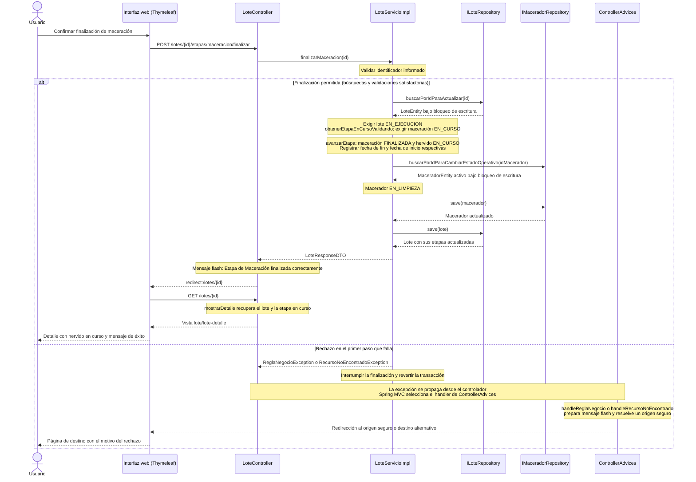

# Diagrama de secuencia de diseño: finalizar maceración

El diagrama muestra cómo `LoteController.finalizarMaceracion` y `LoteServicioImpl.finalizarMaceracion` finalizan la maceración de un lote en ejecución, inician el hervido y dejan el macerador en limpieza. Parte del detalle del lote ya abierto, con un usuario autorizado mediante `LOTE_FINALIZAR_MACERACION`.

## Participantes y abstracción

- **Interfaz web y LoteController:** representan la confirmación desde `lote/lote-detalle.html`, la petición HTTP y el retorno mediante Post-Redirect-Get. El método real `volverDeFinalizarEtapa` prepara el mensaje y redirige al detalle sin fijar pestaña; este abre la etapa en curso.
- **LoteServicioImpl e ILoteRepository:** coordinan la transacción y bloquean el lote para serializar esta operación con consumos, cancelaciones y solicitudes repetidas. El lote permanece `EN_EJECUCION`; maceración pasa a `FINALIZADA` y hervido a `EN_CURSO`. Las etapas se actualizan junto con el lote mediante su cascada de persistencia.
- **IMaceradorRepository:** recupera el macerador activo con bloqueo de escritura y lo guarda en estado operativo `EN_LIMPIEZA`.
- **ControllerAdvices:** maneja los rechazos propagados por el controlador. Una regla incumplida genera una advertencia y un recurso ausente un error. Resuelve una redirección segura a partir del origen del pedido y sus alternativas.

El fragmento permitido presenta el recorrido satisfactorio. La alternativa resume la interrupción en el primer paso que falle: un identificador no informado, un lote fuera de ejecución o una etapa actual distinta de maceración generan `ReglaNegocioException`; un lote inexistente o un macerador no recuperable generan `RecursoNoEncontradoException`. No se ejecutan los pasos posteriores al fallo y la transacción revierte las escrituras previas.

Las validaciones y las transiciones del método real `avanzarEtapa` se agrupan en notas. La maceración no requiere insumos en este modelo: la malta se consume durante molienda. Por eso este flujo no consulta el mínimo de consumo ni libera reservas. Tampoco cambia el estado operativo de la olla ni reencadena el cronograma del fermentador.

Se omiten getters, setters, conversiones a DTO, consultas de presentación del detalle e infraestructura transversal de seguridad y auditoría. Las entidades se representan como datos; sus cambios relevantes quedan visibles en las notas. Los errores técnicos quedan fuera del diagrama.

## Código de referencia

- [LoteController.java](../../../../src/main/java/com/github/heikyudev/maestrocervecero/presentation/controller/lote/LoteController.java): `finalizarMaceracion`, `volverDeFinalizarEtapa` y `mostrarDetalle`.
- [LoteServicioImpl.java](../../../../src/main/java/com/github/heikyudev/maestrocervecero/service/implementation/lote/LoteServicioImpl.java): `finalizarMaceracion`, `obtenerEtapaEnCursoValidando` y `avanzarEtapa`.
- [ILoteRepository.java](../../../../src/main/java/com/github/heikyudev/maestrocervecero/persistence/repository/lote/ILoteRepository.java) e [IMaceradorRepository.java](../../../../src/main/java/com/github/heikyudev/maestrocervecero/persistence/repository/equipamiento/IMaceradorRepository.java): recuperación bajo bloqueo de escritura y persistencia.
- [LoteEntity.java](../../../../src/main/java/com/github/heikyudev/maestrocervecero/persistence/entity/lote/LoteEntity.java): asociación y cascada hacia las etapas.
- [ControllerAdvices.java](../../../../src/main/java/com/github/heikyudev/maestrocervecero/presentation/advice/ControllerAdvices.java): manejo global de rechazos y redirección segura.
