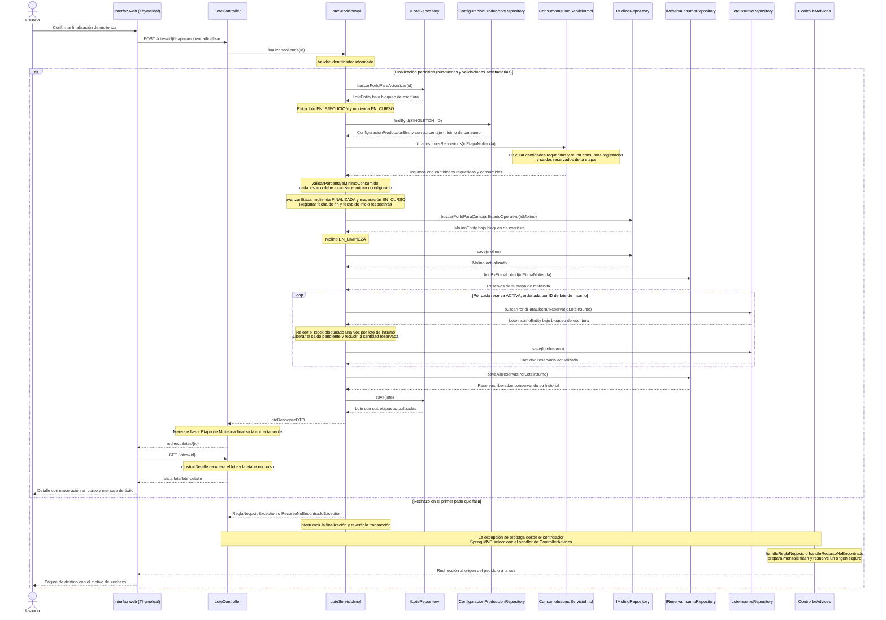

# Diagrama de secuencia de diseño: finalizar molienda

El diagrama muestra cómo `LoteController.finalizarMolienda` y `LoteServicioImpl.finalizarMolienda` finalizan la molienda de un lote en ejecución, verifican su consumo mínimo e inician la maceración. Parte del detalle del lote ya abierto, con un usuario autorizado mediante `LOTE_FINALIZAR_MOLIENDA`.

## Participantes y abstracción

- **Interfaz web y LoteController:** representan la confirmación desde `lote/lote-detalle.html`, la petición HTTP y el retorno mediante Post-Redirect-Get. `volverDeFinalizarEtapa` prepara el mensaje y redirige sin fijar pestaña; el detalle abre la etapa en curso.
- **LoteServicioImpl e ILoteRepository:** coordinan la transacción y bloquean el lote para serializar la finalización con los consumos, la cancelación y solicitudes repetidas. El lote permanece `EN_EJECUCION`; cambian sus etapas de molienda y maceración.
- **IConfiguracionProduccionRepository y ConsumoInsumoServicioImpl:** aportan el mínimo configurado y las cantidades requeridas/consumidas de cada insumo. La validación compara cada consumo con su mínimo individual; no basta con alcanzar un porcentaje global. Si el mínimo es cero, no se exige consumo.
- **IMolinoRepository:** bloquea y guarda el molino en `EN_LIMPIEZA`. No lo deja disponible automáticamente ni cambia el estado operativo del macerador.
- **IReservaInsumoRepository e ILoteInsumoRepository:** liberan únicamente los saldos de reservas activas de molienda, conservando su historial. Las reservas de otras etapas y los consumos ya registrados permanecen intactos.
- **ControllerAdvices:** maneja los rechazos que `LoteController` deja propagar. Una regla incumplida genera una advertencia y un recurso ausente un error; la redirección usa un `Referer` seguro del mismo sitio o vuelve a `/`.

El fragmento permitido resume el recorrido satisfactorio; la alternativa representa una interrupción en cualquiera de sus pasos. Un identificador no informado, un estado o etapa incorrectos, o un consumo insuficiente provocan `ReglaNegocioException`. La falta de un recurso consultado provoca `RecursoNoEncontradoException`. No se ejecutan los pasos posteriores al fallo y se revierten las escrituras previas. El mensaje de consumo insuficiente reúne los insumos que no alcanzaron el mínimo.

Para mantener el nivel de diseño, `filtrarInsumosRequeridos` encapsula las consultas de etapa, consumos registrados y saldos reservados, y la colaboración con `EscaladoInsumoServicioImpl` para calcular requerimientos. La liberación conserva visibles los bloqueos y la persistencia; la relectura mediante `EntityManager.refresh` se resume en una nota porque evita sobrescribir stock con valores cargados antes del bloqueo. No se consume malta automáticamente al finalizar: se verifica el consumo existente y se devuelve a disponibilidad el saldo reservado restante.

Se omiten getters, setters, conversiones a DTO, redondeos, infraestructura transversal de seguridad y auditoría, y consultas de presentación del detalle. Las entidades se representan como datos y sus transiciones se agrupan en notas. La actualización de las etapas se persiste en cascada con el lote; este flujo no reencadena el cronograma del fermentador. Los errores técnicos quedan fuera del diagrama.

## Código de referencia

- [LoteController.java](../../../../src/main/java/com/github/heikyudev/maestrocervecero/presentation/controller/lote/LoteController.java): `finalizarMolienda`, `volverDeFinalizarEtapa` y `mostrarDetalle`.
- [LoteServicioImpl.java](../../../../src/main/java/com/github/heikyudev/maestrocervecero/service/implementation/lote/LoteServicioImpl.java): `finalizarMolienda`, `validarPorcentajeMinimoConsumido`, `avanzarEtapa` y liberación de reservas.
- [ConsumoInsumoServicioImpl.java](../../../../src/main/java/com/github/heikyudev/maestrocervecero/service/implementation/lote/ConsumoInsumoServicioImpl.java): `filtrarInsumosRequeridos`.
- [ILoteRepository.java](../../../../src/main/java/com/github/heikyudev/maestrocervecero/persistence/repository/lote/ILoteRepository.java), [IReservaInsumoRepository.java](../../../../src/main/java/com/github/heikyudev/maestrocervecero/persistence/repository/lote/IReservaInsumoRepository.java) e [ILoteInsumoRepository.java](../../../../src/main/java/com/github/heikyudev/maestrocervecero/persistence/repository/ingreso_insumo/ILoteInsumoRepository.java): bloqueo del lote y liberación de reservas.
- [ReservaInsumoEntity.java](../../../../src/main/java/com/github/heikyudev/maestrocervecero/persistence/entity/lote/ReservaInsumoEntity.java): `liberar` y conservación del historial de cantidades.
- [ControllerAdvices.java](../../../../src/main/java/com/github/heikyudev/maestrocervecero/presentation/advice/ControllerAdvices.java): manejo de rechazos y redirección segura.
