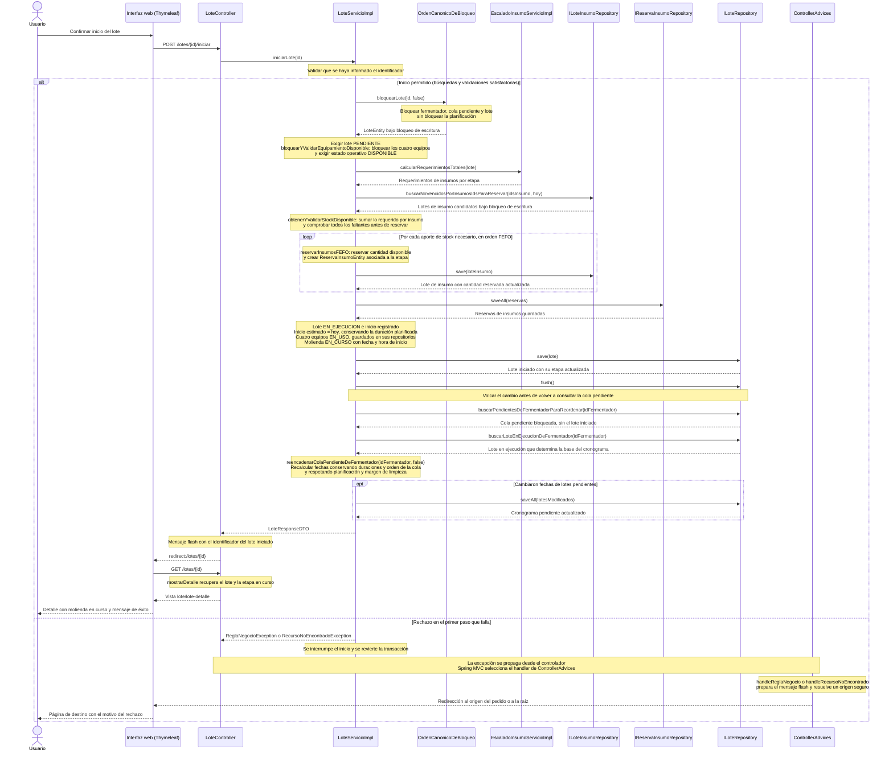

# Diagrama de secuencia de diseño: iniciar lote

El diagrama muestra cómo `LoteController.iniciarLote` y `LoteServicioImpl.iniciarLote` coordinan el inicio de un lote pendiente: reservan sus insumos, ocupan los equipos, activan la molienda y ajustan el cronograma del fermentador. Parte del detalle del lote ya abierto, con un usuario autorizado mediante `LOTE_INICIAR`.

## Participantes y abstracción

- **Interfaz web y LoteController:** representan la confirmación de inicio desde `lote/lote-detalle.html`, la petición HTTP y la redirección al detalle. No existe un formulario de alta que deba reconstruirse en este flujo.
- **LoteServicioImpl y OrdenCanonicoDeBloqueo:** coordinan la transacción y el bloqueo pesimista en orden canónico. El componente de bloqueo encapsula sus consultas reales a `IFermentadorRepository` e `ILoteRepository`; el parámetro `false` indica que esta operación no bloquea la planificación.
- **EscaladoInsumoServicioImpl:** calcula los requerimientos usando la receta de la planificación, el volumen y la instantánea de escalado del lote. Asocia malta a molienda, levadura a fermentación y lúpulo a la etapa configurada.
- **ILoteInsumoRepository e IReservaInsumoRepository:** bloquean stock no vencido y persisten las cantidades reservadas y las reservas por etapa. FEFO prioriza el vencimiento más próximo. Se comprueba el stock total requerido por cada insumo antes de crear reservas; si falta stock, el mensaje reúne todos los faltantes.
- **ILoteRepository:** guarda el inicio y permite reencadenar el cronograma. El `flush` se mantiene visible porque garantiza que la consulta de pendientes ya no incluya el lote que acaba de iniciarse.
- **ControllerAdvices:** maneja los rechazos propagados; `LoteController` no los captura. Una regla de negocio produce una alerta de advertencia y un recurso inexistente una alerta de error. La vuelta utiliza el `Referer` solo si es seguro y del mismo sitio; en otro caso vuelve a `/`.

El fragmento de inicio permitido resume el recorrido satisfactorio; la alternativa de rechazo representa una interrupción en cualquiera de sus pasos, incluso al validar las fechas del cronograma. No se ejecutan los pasos posteriores al fallo y las escrituras previas se revierten. Los errores técnicos y la infraestructura transversal de seguridad y auditoría quedan fuera del diagrama.

Para mantener el nivel de diseño, se encapsulan las consultas `buscarPorIdParaCambiarEstadoOperativo` y los `save` de `IMolinoRepository`, `IMaceradorRepository`, `IOllaHervorRepository` e `IFermentadorRepository`. Los cuatro equipos se ocupan al iniciar el lote; solo la molienda pasa a `EN_CURSO`. Las reservas comprometen stock para las etapas: el consumo efectivo se registra posteriormente.

El reencadenado conserva el orden y la duración de los lotes pendientes, respeta el inicio de sus planificaciones y sitúa la cola después del lote en ejecución con el margen de limpieza. Se omiten las fórmulas de fechas, getters, setters, conversiones a DTO y consultas de presentación del detalle. Las entidades se representan como datos porque sus cambios relevantes quedan resumidos en las notas.

## Código de referencia

- [LoteController.java](../../../../src/main/java/com/github/heikyudev/maestrocervecero/presentation/controller/lote/LoteController.java): `iniciarLote`, `redirigirAlDetalle` y `mostrarDetalle`.
- [LoteServicioImpl.java](../../../../src/main/java/com/github/heikyudev/maestrocervecero/service/implementation/lote/LoteServicioImpl.java): `iniciarLote`, validación de equipos y stock, reservas FEFO y reencadenado.
- [OrdenCanonicoDeBloqueo.java](../../../../src/main/java/com/github/heikyudev/maestrocervecero/service/implementation/lote/OrdenCanonicoDeBloqueo.java): `bloquearLote`.
- [EscaladoInsumoServicioImpl.java](../../../../src/main/java/com/github/heikyudev/maestrocervecero/service/implementation/lote/EscaladoInsumoServicioImpl.java): `calcularRequerimientosTotales`.
- [ILoteInsumoRepository.java](../../../../src/main/java/com/github/heikyudev/maestrocervecero/persistence/repository/ingreso_insumo/ILoteInsumoRepository.java), [IReservaInsumoRepository.java](../../../../src/main/java/com/github/heikyudev/maestrocervecero/persistence/repository/lote/IReservaInsumoRepository.java) e [ILoteRepository.java](../../../../src/main/java/com/github/heikyudev/maestrocervecero/persistence/repository/lote/ILoteRepository.java): stock, reservas y cronograma.
- [ControllerAdvices.java](../../../../src/main/java/com/github/heikyudev/maestrocervecero/presentation/advice/ControllerAdvices.java): handlers de negocio y redirección segura con mensaje.
