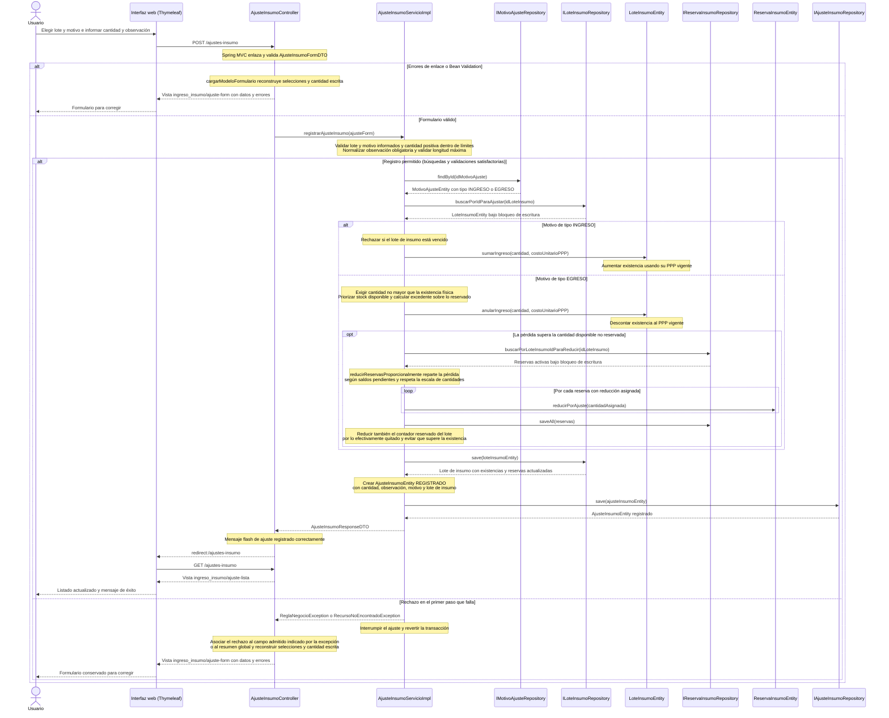

# Diagrama de secuencia de diseño: registrar ajuste de insumo

El diagrama muestra cómo `AjusteInsumoController.registrarAjuste` y `AjusteInsumoServicioImpl.registrarAjusteInsumo` corrigen las existencias de un lote de insumo según un motivo de ingreso o egreso. Incluye el efecto de una pérdida física sobre las reservas. Parte del formulario ya abierto, con un usuario autorizado mediante `AJUSTE_INSUMO_REGISTRAR`.

## Participantes y abstracción

- **Interfaz web y AjusteInsumoController:** representan `ingreso_insumo/ajuste-form.html`, el envío HTTP y el listado `ingreso_insumo/ajuste-lista.html`. El éxito utiliza Post-Redirect-Get. Los errores vuelven a renderizar el formulario en la misma petición, conservando selecciones y la cantidad tal como se escribió.
- **AjusteInsumoServicioImpl e IMotivoAjusteRepository:** coordinan el registro transaccional y resuelven el motivo cuyo tipo decide si se agrega o descuenta stock. El tipo no se decide por el signo de la cantidad, que siempre debe ser positivo.
- **ILoteInsumoRepository y LoteInsumoEntity:** recuperan el lote bajo bloqueo y aplican la corrección de existencia. El ingreso usa `sumarIngreso` y el egreso reutiliza `anularIngreso`, ambos con el PPP vigente del lote. En este contexto, ese segundo método descuenta cantidad y no anula un movimiento de ingreso registrado.
- **IReservaInsumoRepository y ReservaInsumoEntity:** intervienen si un egreso supera la cantidad disponible no reservada. Recuperan y bloquean reservas activas de ese lote de insumo, sin limitarse a un único lote de producción, y aplican `reducirPorAjuste` sobre su saldo pendiente.
- **IAjusteInsumoRepository:** guarda el ajuste `REGISTRADO`, vinculado al motivo y al lote de insumo para mantener la trazabilidad de la corrección.

La cantidad debe estar informada, ser finita, positiva, no superar el máximo técnico y respetar hasta cuatro decimales. La observación es obligatoria y tiene longitud máxima. Un ajuste de ingreso no puede aumentar un lote vencido. Un egreso sí puede aplicarse sobre un lote vencido, pero nunca descontar más cantidad que su existencia física.

El egreso utiliza primero la cantidad disponible. Si no alcanza, la pérdida restante reduce proporcionalmente las reservas activas. El reparto preserva la suma y respeta los saldos mediante el método del mayor resto, cuyo cálculo interno se resume. Cada reserva conserva lo quitado en `cantidadReducidaPorAjuste`, separado de lo consumido o liberado. Si se agota su saldo sin consumo completo queda liberada. La cantidad reservada agregada del lote se ajusta por la reducción efectiva y no puede superar lo que físicamente queda.

El ajuste no tiene un costo de compra propio: utiliza el PPP vigente para corregir cantidad, sin introducir un nuevo precio. Las operaciones de dominio se conservan visibles porque explican la colaboración entre stock y reservas. Las demás modificaciones y la creación del registro se agrupan en notas.

El fragmento permitido resume el recorrido satisfactorio. Cada rechazo interrumpe el primer paso que falle y la transacción revierte las escrituras previas, incluidas las reducciones de reservas. El controlador captura tanto reglas de negocio como recursos inexistentes y muestra el error en el campo admitido indicado por la excepción o en el resumen global.

`cargarModeloFormulario` encapsula las consultas de presentación para recuperar insumo, lote y motivo seleccionados. El parámetro auxiliar `idInsumo` se usa para reconstruir la pantalla, mientras el servicio aplica el ajuste al lote identificado en el formulario. Se omiten getters, setters, conversiones a DTO, construcción de entidades, fórmulas, buscadores e infraestructura transversal de seguridad y auditoría. La anulación es un caso de uso independiente y no restaura automáticamente las reservas reducidas. Los errores técnicos quedan fuera del diagrama.

## Código de referencia

- [AjusteInsumoController.java](../../../../src/main/java/com/github/heikyudev/maestrocervecero/presentation/controller/ingreso_insumo/AjusteInsumoController.java): `registrarAjuste`, `cargarModeloFormulario` y manejo de errores.
- [AjusteInsumoServicioImpl.java](../../../../src/main/java/com/github/heikyudev/maestrocervecero/service/implementation/ingreso_insumo/AjusteInsumoServicioImpl.java): `registrarAjusteInsumo`, `aplicarAjusteAlLote`, `descontarDelLote` y `reducirReservasProporcionalmente`.
- [LoteInsumoEntity.java](../../../../src/main/java/com/github/heikyudev/maestrocervecero/persistence/entity/ingreso_insumo/LoteInsumoEntity.java) y [ReservaInsumoEntity.java](../../../../src/main/java/com/github/heikyudev/maestrocervecero/persistence/entity/lote/ReservaInsumoEntity.java): operaciones de stock y reducción de reservas.
- [IMotivoAjusteRepository.java](../../../../src/main/java/com/github/heikyudev/maestrocervecero/persistence/repository/ingreso_insumo/IMotivoAjusteRepository.java), [ILoteInsumoRepository.java](../../../../src/main/java/com/github/heikyudev/maestrocervecero/persistence/repository/ingreso_insumo/ILoteInsumoRepository.java), [IReservaInsumoRepository.java](../../../../src/main/java/com/github/heikyudev/maestrocervecero/persistence/repository/lote/IReservaInsumoRepository.java) e [IAjusteInsumoRepository.java](../../../../src/main/java/com/github/heikyudev/maestrocervecero/persistence/repository/ingreso_insumo/IAjusteInsumoRepository.java): motivo, bloqueos y persistencia.
