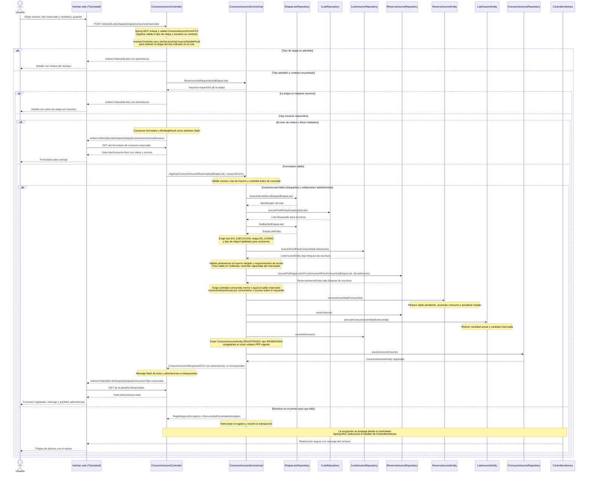

# Diagrama de secuencia de diseño: registrar consumo de insumo reservado

El diagrama muestra cómo `ConsumoInsumoController.registrarConsumoReservado` y `ConsumoInsumoServicioImpl.registrarConsumoInsumoReservado` registran el consumo efectivo contra una reserva de la etapa. Parte del formulario ya abierto, con un usuario autorizado mediante `CONSUMO_INSUMO_REGISTRAR`.

## Participantes y abstracción

- **Interfaz web y ConsumoInsumoController:** representan el formulario `lote/consumo-form.html` y la pantalla `lote/consumo-lista.html`. El identificador de etapa se obtiene del lote y tipo de etapa de la ruta; no se confía a un campo editable del formulario. Las consultas para resolver el contexto y reconstruir pantallas se resumen.
- **ConsumoInsumoServicioImpl, IEtapaLoteRepository e ILoteRepository:** coordinan el registro transaccional y bloquean el lote antes de leer la etapa, para serializar el consumo con su finalización o cancelación. La etapa debe estar en curso dentro de un lote en ejecución y admitir consumos.
- **ILoteInsumoRepository e IReservaInsumoRepository:** recuperan bajo bloqueo el stock y la reserva correspondiente a esa etapa y lote de insumo. El consumo debe ser positivo y respetar el máximo técnico y el saldo reservado. Si no hay reserva, se rechaza esta operación; no se cambia automáticamente al consumo directo.
- **ReservaInsumoEntity y LoteInsumoEntity:** tienen líneas de vida porque realizan operaciones de dominio significativas. `consumir` actualiza saldo, cantidad consumida y estado de la reserva; `ejecutarConsumo` descuenta tanto existencia física como cantidad reservada del stock.
- **IConsumoInsumoRepository:** persiste el consumo `REGISTRADO` de tipo `RESERVADO`, vinculado a etapa y lote de insumo, con el costo unitario PPP congelado para trazabilidad.
- **ControllerAdvices:** maneja las excepciones propagadas mediante `handleReglaNegocio` o `handleRecursoNoEncontrado`, con una advertencia o error y redirección segura. También interviene si falla la resolución del contexto previa al registro, resumida en las notas iniciales.

Los errores de validación MVC generan Post-Redirect-Get hacia el formulario con sus datos y errores en flash, sin registrar consumo. La alternativa transaccional de rechazo representa la interrupción en cualquier paso que falle: no se ejecutan los siguientes y se revierten las escrituras previas. Los errores técnicos quedan fuera del diagrama.

Las validaciones de requerimientos y la construcción de advertencias encapsulan llamadas a `EscaladoInsumoServicioImpl` y consultas de consumos registrados. Se distingue entre un rechazo y una advertencia: un lote de insumo vencido o un total consumido superior al requerido permiten registrar el consumo y devuelven avisos. El control de capacidad para malta molida sí puede impedirlo.

Se omiten getters, setters, construcción de entidades, conversiones a DTO, redondeos y consultas de presentación o buscadores. El consumo directo y la anulación son casos de uso independientes. No se crea una reserva nueva ni se avanza la etapa al registrar este consumo. La infraestructura transversal de seguridad y auditoría se omite.

## Código de referencia

- [ConsumoInsumoController.java](../../../../src/main/java/com/github/heikyudev/maestrocervecero/presentation/controller/lote/ConsumoInsumoController.java): `registrarConsumoReservado`, `registrar`, `resolverContexto` y navegación Post-Redirect-Get.
- [ConsumoInsumoServicioImpl.java](../../../../src/main/java/com/github/heikyudev/maestrocervecero/service/implementation/lote/ConsumoInsumoServicioImpl.java): `registrarConsumoInsumoReservado`, validaciones, bloqueo y advertencias.
- [ReservaInsumoEntity.java](../../../../src/main/java/com/github/heikyudev/maestrocervecero/persistence/entity/lote/ReservaInsumoEntity.java) y [LoteInsumoEntity.java](../../../../src/main/java/com/github/heikyudev/maestrocervecero/persistence/entity/ingreso_insumo/LoteInsumoEntity.java): operaciones de consumo sobre reserva y stock.
- [IEtapaLoteRepository.java](../../../../src/main/java/com/github/heikyudev/maestrocervecero/persistence/repository/lote/IEtapaLoteRepository.java), [ILoteRepository.java](../../../../src/main/java/com/github/heikyudev/maestrocervecero/persistence/repository/lote/ILoteRepository.java), [ILoteInsumoRepository.java](../../../../src/main/java/com/github/heikyudev/maestrocervecero/persistence/repository/ingreso_insumo/ILoteInsumoRepository.java) e [IReservaInsumoRepository.java](../../../../src/main/java/com/github/heikyudev/maestrocervecero/persistence/repository/lote/IReservaInsumoRepository.java): búsquedas y bloqueos.
- [IConsumoInsumoRepository.java](../../../../src/main/java/com/github/heikyudev/maestrocervecero/persistence/repository/lote/IConsumoInsumoRepository.java): persistencia del consumo.
- [ControllerAdvices.java](../../../../src/main/java/com/github/heikyudev/maestrocervecero/presentation/advice/ControllerAdvices.java): manejo global de rechazos y redirección segura.
