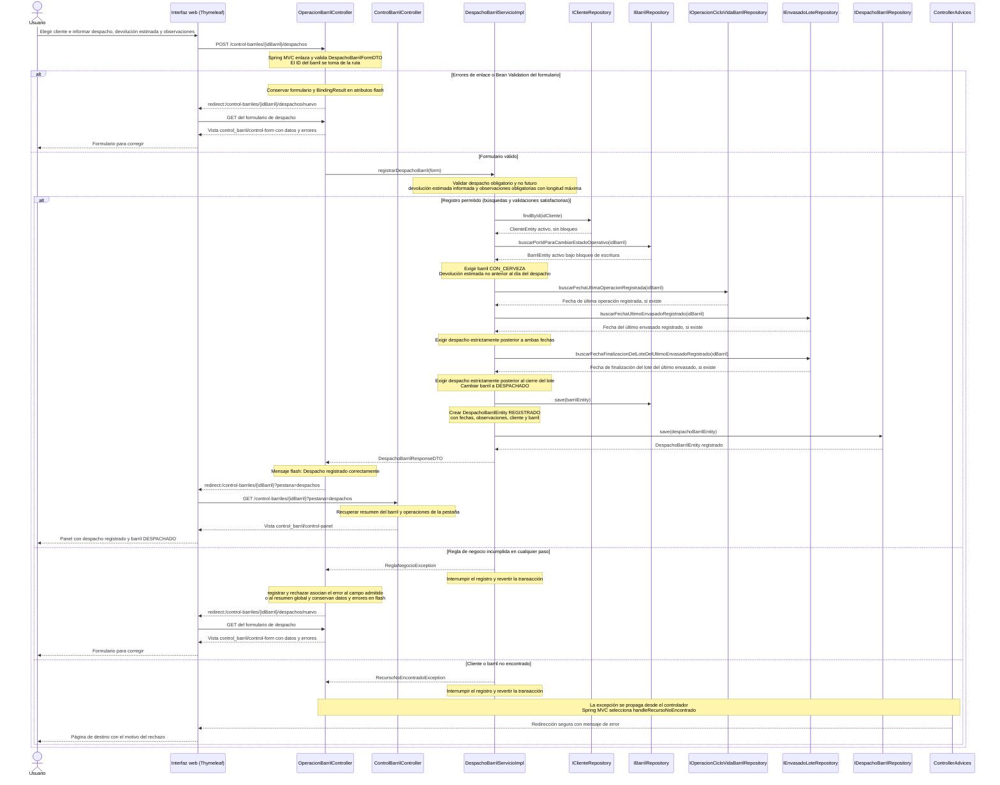

# Diagrama de secuencia de diseño: registrar despacho de barril

El diagrama muestra cómo `OperacionBarrilController.registrarDespacho` y `DespachoBarrilServicioImpl.registrarDespachoBarril` registran la entrega de un barril con cerveza a un cliente y lo dejan despachado. Parte del formulario ya abierto, con un usuario autorizado mediante `DESPACHO_BARRIL_REGISTRAR`.

## Participantes y abstracción

- **Interfaz web, OperacionBarrilController y ControlBarrilController:** representan `control_barril/control-form.html`, la petición HTTP y el retorno mediante Post-Redirect-Get al panel `control_barril/control-panel.html`. El barril procede de la ruta y el formulario aporta el cliente y los datos del despacho. El panel de resultado corresponde a un controlador distinto del que registra.
- **DespachoBarrilServicioImpl e IClienteRepository:** coordinan el registro transaccional y resuelven un cliente activo. El despacho se vincula a `ClienteEntity`, sin una búsqueda de versión de cliente en este caso de uso.
- **IBarrilRepository:** recupera el barril activo bajo bloqueo, exige `CON_CERVEZA` y guarda el cambio a `DESPACHADO`. Es el único bloqueo de escritura de la operación y se toma antes de consultar la actividad previa del barril.
- **IOperacionCicloVidaBarrilRepository e IEnvasadoLoteRepository:** aportan las fechas de la última operación, el último envasado y el cierre del lote que dejó la cerveza en el barril. El despacho debe ser estrictamente posterior a esas actividades cuando existen.
- **IDespachoBarrilRepository:** persiste la operación `REGISTRADO` con cliente, barril, fecha y hora del despacho, fecha estimada de devolución y observaciones.
- **ControllerAdvices:** maneja los recursos inexistentes propagados por el controlador, mediante `handleRecursoNoEncontrado` y una redirección segura con error.

La fecha y hora del despacho son obligatorias y no pueden ser futuras. La devolución estimada es una fecha obligatoria que puede coincidir con el día del despacho, pero no ser anterior. Las observaciones son obligatorias y se normalizan y limitan en longitud. Las reglas compartidas de `MetodosCicloVida` se agrupan en notas.

El fragmento permitido presenta el recorrido satisfactorio. Cada rechazo interrumpe el primer paso que falle y revierte las escrituras del servicio. Las reglas de negocio se capturan en el controlador y se asocian al campo admitido indicado por la excepción o al resumen global. Los errores MVC y esos rechazos conservan los datos y errores en flash y redirigen al formulario, sin dejar al navegador en la URL del POST.

El controlador elimina del resultado de validación el error del ID del barril, porque ese identificador se obtiene de la ruta y no de un campo editable. Al reconstruir el formulario se consultan el resumen del barril y el nombre del cliente seleccionado. Si el estado operativo ya no permite despachar, el GET vuelve al panel con un aviso. Esas consultas de presentación quedan encapsuladas.

Las entidades se representan como datos porque no coordinan colaboraciones significativas en este flujo. Se omiten getters, setters, construcción de entidades, conversiones a DTO, buscadores, consultas internas del panel e infraestructura transversal de seguridad y auditoría. Registrar el despacho no vacía el barril ni registra su devolución. Los errores técnicos quedan fuera del diagrama.

## Código de referencia

- [OperacionBarrilController.java](../../../../src/main/java/com/github/heikyudev/maestrocervecero/presentation/controller/control_barril/OperacionBarrilController.java): `registrarDespacho`, `registrar`, `rechazar` y `mostrarFormulario`.
- [DespachoBarrilServicioImpl.java](../../../../src/main/java/com/github/heikyudev/maestrocervecero/service/implementation/barril/DespachoBarrilServicioImpl.java): `registrarDespachoBarril`.
- [IClienteRepository.java](../../../../src/main/java/com/github/heikyudev/maestrocervecero/persistence/repository/cliente/IClienteRepository.java), [IBarrilRepository.java](../../../../src/main/java/com/github/heikyudev/maestrocervecero/persistence/repository/barril/IBarrilRepository.java), [IOperacionCicloVidaBarrilRepository.java](../../../../src/main/java/com/github/heikyudev/maestrocervecero/persistence/repository/barril/IOperacionCicloVidaBarrilRepository.java), [IEnvasadoLoteRepository.java](../../../../src/main/java/com/github/heikyudev/maestrocervecero/persistence/repository/lote/IEnvasadoLoteRepository.java) e [IDespachoBarrilRepository.java](../../../../src/main/java/com/github/heikyudev/maestrocervecero/persistence/repository/barril/IDespachoBarrilRepository.java): referencias, bloqueo, fechas y persistencia.
- [MetodosCicloVida.java](../../../../src/main/java/com/github/heikyudev/maestrocervecero/util/method/MetodosCicloVida.java): validaciones compartidas de fecha, observaciones y barril.
- [ControlBarrilController.java](../../../../src/main/java/com/github/heikyudev/maestrocervecero/presentation/controller/control_barril/ControlBarrilController.java) y [ControllerAdvices.java](../../../../src/main/java/com/github/heikyudev/maestrocervecero/presentation/advice/ControllerAdvices.java): panel de resultado y manejo global de recursos no encontrados.
