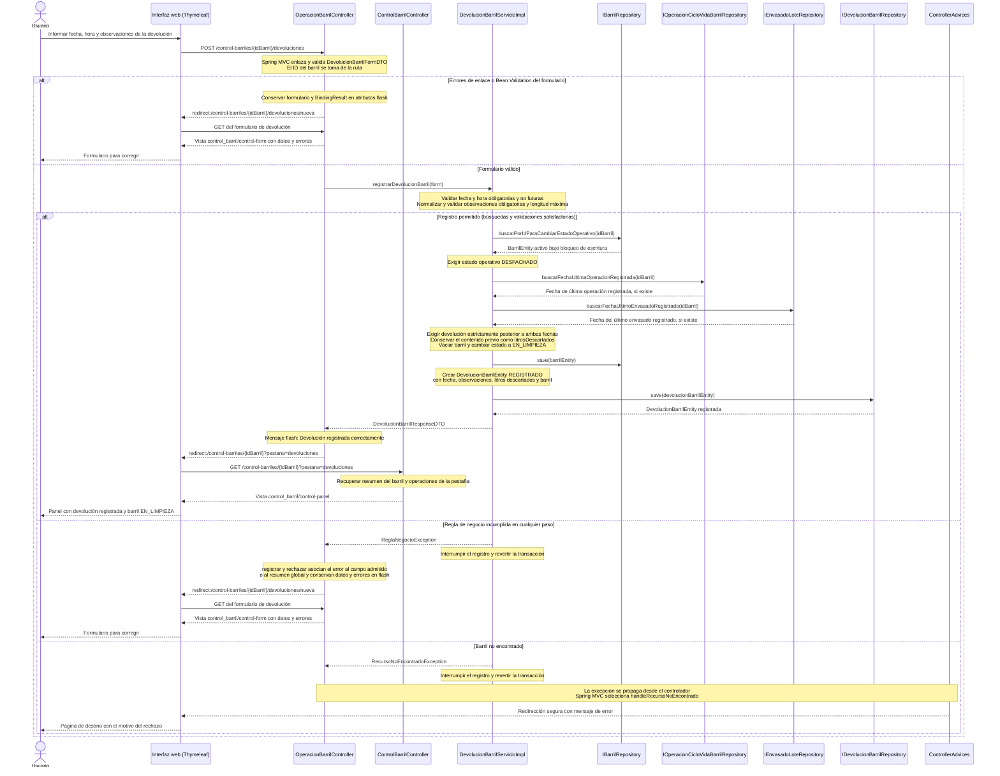

# Diagrama de secuencia de diseño: registrar devolución de barril

El diagrama muestra cómo `OperacionBarrilController.registrarDevolucion` y `DevolucionBarrilServicioImpl.registrarDevolucionBarril` registran el retorno de un barril despachado, descartan su contenido y lo dejan en limpieza. Parte del formulario ya abierto, con un usuario autorizado mediante `DEVOLUCION_BARRIL_REGISTRAR`.

## Participantes y abstracción

- **Interfaz web, OperacionBarrilController y ControlBarrilController:** representan `control_barril/control-form.html`, el envío HTTP y el retorno mediante Post-Redirect-Get al panel `control_barril/control-panel.html`. El barril procede de la ruta. El panel de resultado lo atiende un controlador distinto del que registra.
- **DevolucionBarrilServicioImpl e IBarrilRepository:** coordinan la transacción y recuperan el barril activo bajo bloqueo. Exigen `DESPACHADO`, descartan todo su contenido actual y lo guardan en `EN_LIMPIEZA`. Es el único bloqueo de escritura de la operación y se toma antes de consultar la actividad previa.
- **IOperacionCicloVidaBarrilRepository e IEnvasadoLoteRepository:** aportan la fecha de la última operación y del último envasado registrado. La devolución debe ser estrictamente posterior a ambas cuando existen.
- **IDevolucionBarrilRepository:** persiste la devolución `REGISTRADO`, asociada al barril. Conserva los litros descartados para mantener la trazabilidad y permitir su restitución si después se anula la devolución.
- **ControllerAdvices:** maneja los recursos inexistentes propagados por el controlador mediante `handleRecursoNoEncontrado` y una redirección segura con error.

La devolución no tiene una relación directa con un despacho ni busca un cliente: el modelo exige el estado `DESPACHADO`, que solo deja un despacho registrado. Esa precondición respalda el retorno dentro del ciclo de vida del barril, sin agregar colaboraciones inexistentes al diagrama.

La fecha y hora son obligatorias y no pueden ser futuras. Las observaciones son obligatorias, se normalizan y respetan una longitud máxima. Las reglas compartidas de `MetodosCicloVida` y los cambios de las entidades se agrupan en notas. Registrar la devolución no deja el barril disponible ni ejecuta una limpieza: lo deja vacío y pendiente de limpieza.

El fragmento permitido presenta el recorrido satisfactorio. Cada rechazo interrumpe el primer paso que falle y revierte las escrituras del servicio. Las reglas de negocio se capturan en el controlador y se asocian al campo admitido indicado por la excepción o al resumen global. Los errores MVC y esos rechazos conservan datos y errores en flash y redirigen al formulario.

El controlador elimina del resultado de validación el error del ID del barril, porque ese identificador procede de la ruta. El GET del formulario consulta su resumen y, si el estado ya no permite registrar una devolución, vuelve al panel con un aviso. Esas consultas de presentación se encapsulan.

Las entidades se representan como datos porque no coordinan colaboraciones significativas en este flujo. Se omiten getters, setters, construcción de entidades, conversiones a DTO, consultas internas del panel e infraestructura transversal de seguridad y auditoría. La anulación de la devolución es un caso de uso independiente. Los errores técnicos quedan fuera del diagrama.

## Código de referencia

- [OperacionBarrilController.java](../../../../src/main/java/com/github/heikyudev/maestrocervecero/presentation/controller/control_barril/OperacionBarrilController.java): `registrarDevolucion`, `registrar`, `rechazar` y `mostrarFormulario`.
- [DevolucionBarrilServicioImpl.java](../../../../src/main/java/com/github/heikyudev/maestrocervecero/service/implementation/barril/DevolucionBarrilServicioImpl.java): `registrarDevolucionBarril`.
- [IBarrilRepository.java](../../../../src/main/java/com/github/heikyudev/maestrocervecero/persistence/repository/barril/IBarrilRepository.java), [IOperacionCicloVidaBarrilRepository.java](../../../../src/main/java/com/github/heikyudev/maestrocervecero/persistence/repository/barril/IOperacionCicloVidaBarrilRepository.java), [IEnvasadoLoteRepository.java](../../../../src/main/java/com/github/heikyudev/maestrocervecero/persistence/repository/lote/IEnvasadoLoteRepository.java) e [IDevolucionBarrilRepository.java](../../../../src/main/java/com/github/heikyudev/maestrocervecero/persistence/repository/barril/IDevolucionBarrilRepository.java): bloqueo, fechas y persistencia.
- [MetodosCicloVida.java](../../../../src/main/java/com/github/heikyudev/maestrocervecero/util/method/MetodosCicloVida.java): validaciones compartidas de fecha, observaciones y barril.
- [ControlBarrilController.java](../../../../src/main/java/com/github/heikyudev/maestrocervecero/presentation/controller/control_barril/ControlBarrilController.java) y [ControllerAdvices.java](../../../../src/main/java/com/github/heikyudev/maestrocervecero/presentation/advice/ControllerAdvices.java): panel de resultado y manejo global de recursos no encontrados.
