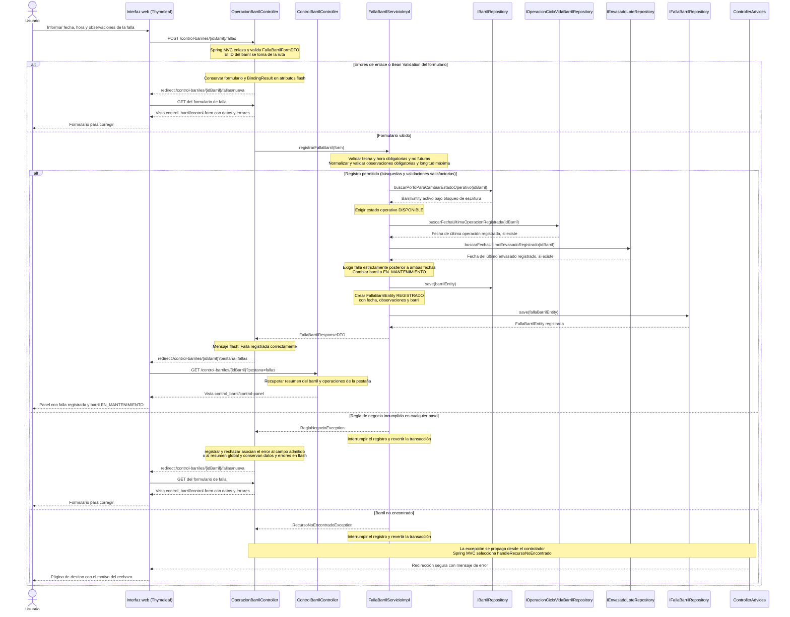

# Diagrama de secuencia de diseño: registrar falla de barril

El diagrama muestra cómo `OperacionBarrilController.registrarFalla` y `FallaBarrilServicioImpl.registrarFallaBarril` registran una falla y dejan el barril en mantenimiento. Parte del formulario ya abierto, con un usuario autorizado mediante `FALLA_BARRIL_REGISTRAR`.

## Participantes y abstracción

- **Interfaz web, OperacionBarrilController y ControlBarrilController:** representan `control_barril/control-form.html`, el envío HTTP y el retorno mediante Post-Redirect-Get al panel `control_barril/control-panel.html`. El ID del barril procede de la ruta. El panel de resultado lo atiende un controlador distinto del que registra.
- **FallaBarrilServicioImpl e IBarrilRepository:** coordinan la transacción y recuperan el barril activo bajo bloqueo. Exigen `DISPONIBLE` y guardan la transición a `EN_MANTENIMIENTO`. Es el único bloqueo de escritura de la operación y se toma antes de consultar el historial.
- **IOperacionCicloVidaBarrilRepository e IEnvasadoLoteRepository:** aportan las fechas de la última operación y del último envasado registrado. La falla debe ser estrictamente posterior a ambas cuando existen.
- **IFallaBarrilRepository:** persiste la falla `REGISTRADO`, asociada al barril y con su fecha y observaciones.
- **ControllerAdvices:** maneja los recursos inexistentes propagados por el controlador mediante `handleRecursoNoEncontrado` y una redirección segura con error.

La fecha y hora son obligatorias y no pueden ser futuras. Las observaciones también son obligatorias, se normalizan y respetan una longitud máxima. Las validaciones compartidas de `MetodosCicloVida` y los cambios de las entidades se agrupan en notas.

La precondición `DISPONIBLE` impide registrar esta falla sobre un barril en uso, con cerveza, despachado, en limpieza o ya en mantenimiento. El caso de uso cambia su disponibilidad operativa sin modificar su contenido, crear un mantenimiento o alterar un lote de producción automáticamente.

El fragmento permitido presenta el recorrido satisfactorio. Cada rechazo interrumpe el primer paso que falle y revierte las escrituras del servicio. Las reglas de negocio se capturan en el controlador y se asocian al campo admitido indicado por la excepción o al resumen global. Los errores MVC y esos rechazos conservan datos y errores en flash y redirigen al formulario.

El controlador elimina del resultado de validación el error del ID del barril, porque ese identificador procede de la ruta. El GET del formulario consulta su resumen y, si el estado ya no permite registrar una falla, vuelve al panel con un aviso. Esas consultas de presentación quedan encapsuladas.

Las entidades se representan como datos porque no coordinan colaboraciones significativas en este flujo. Se omiten getters, setters, construcción de entidades, conversiones a DTO, consultas internas del panel e infraestructura transversal de seguridad y auditoría. No se registra un costo en esta operación. La anulación es un caso de uso independiente. Los errores técnicos quedan fuera del diagrama.

## Código de referencia

- [OperacionBarrilController.java](../../../../src/main/java/com/github/heikyudev/maestrocervecero/presentation/controller/control_barril/OperacionBarrilController.java): `registrarFalla`, `registrar`, `rechazar` y `mostrarFormulario`.
- [FallaBarrilServicioImpl.java](../../../../src/main/java/com/github/heikyudev/maestrocervecero/service/implementation/barril/FallaBarrilServicioImpl.java): `registrarFallaBarril`.
- [IBarrilRepository.java](../../../../src/main/java/com/github/heikyudev/maestrocervecero/persistence/repository/barril/IBarrilRepository.java), [IOperacionCicloVidaBarrilRepository.java](../../../../src/main/java/com/github/heikyudev/maestrocervecero/persistence/repository/barril/IOperacionCicloVidaBarrilRepository.java), [IEnvasadoLoteRepository.java](../../../../src/main/java/com/github/heikyudev/maestrocervecero/persistence/repository/lote/IEnvasadoLoteRepository.java) e [IFallaBarrilRepository.java](../../../../src/main/java/com/github/heikyudev/maestrocervecero/persistence/repository/barril/IFallaBarrilRepository.java): bloqueo, fechas y persistencia.
- [MetodosCicloVida.java](../../../../src/main/java/com/github/heikyudev/maestrocervecero/util/method/MetodosCicloVida.java): validaciones compartidas de fecha, observaciones y barril.
- [ControlBarrilController.java](../../../../src/main/java/com/github/heikyudev/maestrocervecero/presentation/controller/control_barril/ControlBarrilController.java) y [ControllerAdvices.java](../../../../src/main/java/com/github/heikyudev/maestrocervecero/presentation/advice/ControllerAdvices.java): panel de resultado y manejo global de recursos no encontrados.
