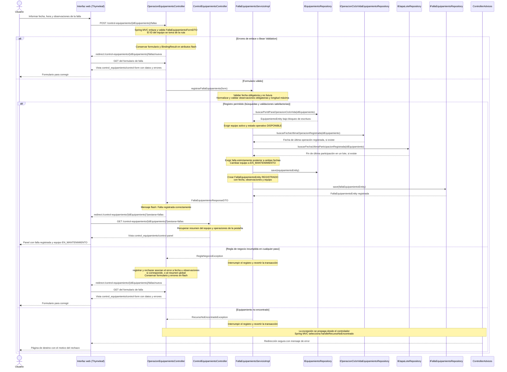

# Diagrama de secuencia de diseño: registrar falla de equipamiento

El diagrama muestra cómo `OperacionEquipamientoController.registrarFalla` y `FallaEquipamientoServicioImpl.registrarFallaEquipamiento` registran una falla y dejan el equipo en mantenimiento. Parte del formulario ya abierto, con un usuario autorizado mediante `FALLA_EQUIPAMIENTO_REGISTRAR`.

## Participantes y abstracción

- **Interfaz web, OperacionEquipamientoController y ControlEquipamientoController:** representan `control_equipamiento/control-form.html`, el envío HTTP y el retorno mediante Post-Redirect-Get al panel `control_equipamiento/control-panel.html`. El ID del equipo procede de la ruta y se incorpora al formulario antes de delegar el registro. El panel de resultado lo atiende un controlador distinto del que registra.
- **FallaEquipamientoServicioImpl e IEquipamientoRepository:** coordinan la transacción, recuperan el equipo bajo bloqueo y exigen que esté activo y `DISPONIBLE`. Es el único bloqueo de escritura de la operación y se toma antes de consultar la actividad previa. El estado final es `EN_MANTENIMIENTO`.
- **IOperacionCicloVidaEquipamientoRepository e IEtapaLoteRepository:** aportan la fecha de la última operación registrada y el fin de la última participación del equipo en un lote. La falla debe ser estrictamente posterior a ambas cuando existen.
- **IFallaEquipamientoRepository:** persiste la falla `REGISTRADO`, asociada al equipo y con su fecha y observaciones.
- **ControllerAdvices:** maneja los recursos inexistentes propagados por el controlador mediante `handleRecursoNoEncontrado` y una redirección segura con error.

La fecha y hora son obligatorias y no pueden ser futuras. Las observaciones también son obligatorias, se normalizan y respetan una longitud máxima. Las reglas compartidas de `MetodosCicloVidaEquipamiento` y las modificaciones de las entidades se agrupan en notas.

La precondición `DISPONIBLE` impide registrar esta falla sobre un equipo que esté en uso, en limpieza o ya en mantenimiento. Este caso de uso deja el equipo pendiente de mantenimiento, sin crear un registro de mantenimiento ni cancelar o modificar lotes de producción automáticamente.

El fragmento permitido presenta el recorrido satisfactorio. Cada rechazo interrumpe el primer paso que falle y revierte las escrituras del servicio. Las reglas de negocio se capturan en el controlador y se asocian a `fecha` u `observaciones` cuando la excepción lo indica, o al resumen global en otro caso. Los errores MVC y esos rechazos conservan los datos y errores en flash y redirigen al formulario.

El GET del formulario consulta el resumen del equipo y, si su estado ya no permite registrar una falla, vuelve al panel con un aviso. Las consultas de presentación y los métodos comunes del controlador `registrar`, `rechazar` y `mostrarFormulario` se encapsulan para mantener el nivel de diseño.

Las entidades se representan como datos porque no coordinan colaboraciones significativas en este flujo. Se omiten getters, setters, construcción de entidades, conversiones a DTO, consultas internas del panel e infraestructura transversal de seguridad y auditoría. No se registra un costo en esta operación. La anulación es un caso de uso independiente. Los errores técnicos quedan fuera del diagrama.

## Código de referencia

- [OperacionEquipamientoController.java](../../../../src/main/java/com/github/heikyudev/maestrocervecero/presentation/controller/control_equipamiento/OperacionEquipamientoController.java): `registrarFalla`, `registrar`, `rechazar` y `mostrarFormulario`.
- [FallaEquipamientoServicioImpl.java](../../../../src/main/java/com/github/heikyudev/maestrocervecero/service/implementation/equipamiento/FallaEquipamientoServicioImpl.java): `registrarFallaEquipamiento`.
- [MetodosCicloVidaEquipamiento.java](../../../../src/main/java/com/github/heikyudev/maestrocervecero/util/method/equipamiento/MetodosCicloVidaEquipamiento.java): reglas de fecha, observaciones, equipo activo y estado operativo.
- [IEquipamientoRepository.java](../../../../src/main/java/com/github/heikyudev/maestrocervecero/persistence/repository/equipamiento/IEquipamientoRepository.java), [IOperacionCicloVidaEquipamientoRepository.java](../../../../src/main/java/com/github/heikyudev/maestrocervecero/persistence/repository/equipamiento/IOperacionCicloVidaEquipamientoRepository.java), [IEtapaLoteRepository.java](../../../../src/main/java/com/github/heikyudev/maestrocervecero/persistence/repository/lote/IEtapaLoteRepository.java) e [IFallaEquipamientoRepository.java](../../../../src/main/java/com/github/heikyudev/maestrocervecero/persistence/repository/equipamiento/IFallaEquipamientoRepository.java): bloqueo, historial y persistencia.
- [ControlEquipamientoController.java](../../../../src/main/java/com/github/heikyudev/maestrocervecero/presentation/controller/control_equipamiento/ControlEquipamientoController.java) y [ControllerAdvices.java](../../../../src/main/java/com/github/heikyudev/maestrocervecero/presentation/advice/ControllerAdvices.java): panel de resultado y manejo global de recursos no encontrados.
