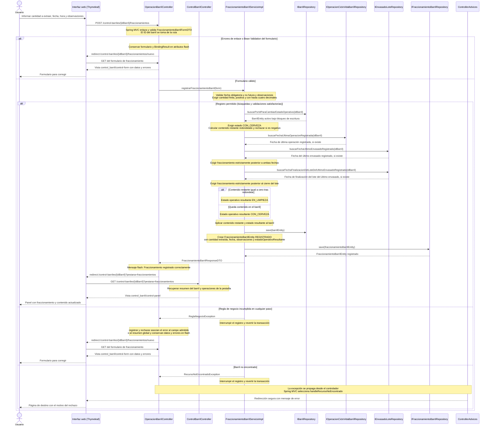

# Diagrama de secuencia de diseño: registrar fraccionamiento de barril

El diagrama muestra cómo `OperacionBarrilController.registrarFraccionamiento` y `FraccionamientoBarrilServicioImpl.registrarFraccionamientoBarril` registran una extracción de cerveza y actualizan el contenido y estado operativo del barril. Parte del formulario ya abierto, con un usuario autorizado mediante `FRACCIONAMIENTO_BARRIL_REGISTRAR`.

## Participantes y abstracción

- **Interfaz web, OperacionBarrilController y ControlBarrilController:** representan `control_barril/control-form.html`, el envío HTTP y el retorno mediante Post-Redirect-Get al panel `control_barril/control-panel.html`. El ID del barril procede de la ruta. El panel de resultado lo atiende un controlador distinto del que registra.
- **FraccionamientoBarrilServicioImpl e IBarrilRepository:** coordinan la transacción y recuperan el barril activo bajo bloqueo. Exigen `CON_CERVEZA`, descuentan la cantidad extraída y persisten contenido y estado resultantes. Es el único bloqueo de escritura de la operación y se toma antes de leer contenido e historial.
- **IOperacionCicloVidaBarrilRepository e IEnvasadoLoteRepository:** aportan las fechas de la última operación, del último envasado y de finalización de su lote. El fraccionamiento debe ser estrictamente posterior a esas actividades cuando existen.
- **IFraccionamientoBarrilRepository:** persiste la operación `REGISTRADO`, vinculada al barril. Conserva la cantidad fraccionada y el `estadoOperativoResultante` exacto para que una futura anulación pueda comprobarlo y restituir el contenido.
- **ControllerAdvices:** maneja los recursos inexistentes propagados por el controlador mediante `handleRecursoNoEncontrado` y una redirección segura con error.

La cantidad extraída debe estar informada, ser finita y positiva, y tener como máximo cuatro decimales. El servicio resta esa cantidad al contenido actual y redondea el resultado a la escala de cantidades. Un resultado negativo rechaza el registro. Un resultado cero deja el barril `EN_LIMPIEZA`, mientras que un remanente positivo lo mantiene `CON_CERVEZA`. El redondeo evita que residuos de punto flotante impidan reconocer un barril vacío.

La fecha y hora son obligatorias y no pueden ser futuras. Las observaciones también son obligatorias, se normalizan y tienen longitud máxima. Las validaciones compartidas de `MetodosCicloVida` y las modificaciones de las entidades se agrupan en notas. Registrar un fraccionamiento no crea un despacho ni ejecuta una limpieza.

El fragmento permitido presenta el recorrido satisfactorio. Cada rechazo interrumpe el primer paso que falle y revierte las escrituras del servicio. Las reglas de negocio se capturan en el controlador y se asocian al campo admitido indicado por la excepción o al resumen global. Los errores MVC y esos rechazos conservan datos y errores en flash y redirigen al formulario.

El controlador elimina del resultado de validación el error del ID del barril, porque ese identificador procede de la ruta. El GET del formulario consulta su resumen y, si el estado ya no permite fraccionar, vuelve al panel con un aviso. Esas consultas de presentación quedan encapsuladas.

Las entidades se representan como datos porque no coordinan colaboraciones significativas en este flujo. Se omiten getters, setters, construcción de entidades, conversiones a DTO, consultas internas del panel e infraestructura transversal de seguridad y auditoría. La anulación es un caso de uso independiente. Los errores técnicos quedan fuera del diagrama.

## Código de referencia

- [OperacionBarrilController.java](../../../../src/main/java/com/github/heikyudev/maestrocervecero/presentation/controller/control_barril/OperacionBarrilController.java): `registrarFraccionamiento`, `registrar`, `rechazar` y `mostrarFormulario`.
- [FraccionamientoBarrilServicioImpl.java](../../../../src/main/java/com/github/heikyudev/maestrocervecero/service/implementation/barril/FraccionamientoBarrilServicioImpl.java): `registrarFraccionamientoBarril`.
- [IBarrilRepository.java](../../../../src/main/java/com/github/heikyudev/maestrocervecero/persistence/repository/barril/IBarrilRepository.java), [IOperacionCicloVidaBarrilRepository.java](../../../../src/main/java/com/github/heikyudev/maestrocervecero/persistence/repository/barril/IOperacionCicloVidaBarrilRepository.java), [IEnvasadoLoteRepository.java](../../../../src/main/java/com/github/heikyudev/maestrocervecero/persistence/repository/lote/IEnvasadoLoteRepository.java) e [IFraccionamientoBarrilRepository.java](../../../../src/main/java/com/github/heikyudev/maestrocervecero/persistence/repository/barril/IFraccionamientoBarrilRepository.java): bloqueo, fechas y persistencia.
- [MetodosCicloVida.java](../../../../src/main/java/com/github/heikyudev/maestrocervecero/util/method/MetodosCicloVida.java): validaciones compartidas de fecha, observaciones y barril.
- [ControlBarrilController.java](../../../../src/main/java/com/github/heikyudev/maestrocervecero/presentation/controller/control_barril/ControlBarrilController.java) y [ControllerAdvices.java](../../../../src/main/java/com/github/heikyudev/maestrocervecero/presentation/advice/ControllerAdvices.java): panel de resultado y manejo global de recursos no encontrados.
