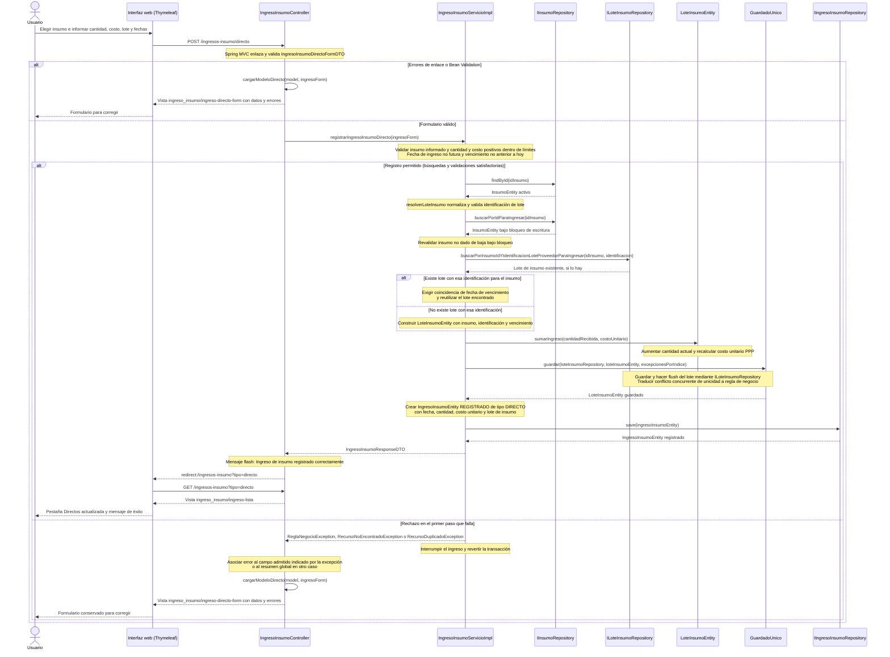

# Diagrama de secuencia de diseño: registrar ingreso directo de insumo

El diagrama muestra cómo `IngresoInsumoController.registrarIngresoDirecto` y `IngresoInsumoServicioImpl.registrarIngresoInsumoDirecto` incorporan insumos al stock sin una orden de compra, actualizando su precio promedio ponderado. Parte del formulario ya abierto, con un usuario autorizado mediante `INGRESO_INSUMO_REGISTRAR`.

## Participantes y abstracción

- **Interfaz web e IngresoInsumoController:** representan `ingreso_insumo/ingreso-directo-form.html`, la petición HTTP y el listado `ingreso_insumo/ingreso-lista.html`. El éxito utiliza Post-Redirect-Get hacia la pestaña Directos. Los errores vuelven a renderizar el formulario en la misma petición, conservando lo ingresado.
- **IngresoInsumoServicioImpl e IInsumoRepository:** coordinan el registro transaccional, resuelven el insumo activo y bloquean su fila antes de buscar o crear el lote. El estado se vuelve a validar sobre el insumo bloqueado para evitar una baja concurrente.
- **ILoteInsumoRepository:** localiza el lote por insumo e identificación del proveedor, sin distinguir mayúsculas. Si existe, debe tener el mismo vencimiento. Si falta, se construye un lote nuevo. El bloqueo del insumo serializa los ingresos simultáneos que podrían intentar crear el mismo lote.
- **LoteInsumoEntity:** tiene línea de vida porque su método real `sumarIngreso` incorpora la cantidad recibida y recalcula el precio promedio ponderado (PPP), combinando el valor y la cantidad anteriores con el nuevo aporte.
- **GuardadoUnico e IIngresoInsumoRepository:** el helper persiste el stock y hace `flush` para traducir un eventual conflicto de unicidad dentro del servicio. El repositorio de ingresos conserva el movimiento `REGISTRADO` de tipo `DIRECTO`, con cantidad y costo unitario originales para trazabilidad.

La cantidad se informa directamente en la unidad de medida del insumo y el costo por esa misma unidad. Ambos son obligatorios, positivos, respetan sus máximos técnicos y admiten hasta cuatro decimales. La cantidad además debe ser finita. Las fechas son obligatorias: el ingreso no puede ser futuro y el vencimiento no puede ser anterior a hoy. La identificación del lote también es obligatoria y tiene longitud máxima. Estas comprobaciones internas se agrupan en notas.

El fragmento permitido resume el recorrido satisfactorio. Cada rechazo interrumpe el primer paso que falle, sin ejecutar los siguientes, y la transacción revierte las escrituras previas, incluido el cambio de stock y PPP. Un lote existente con vencimiento diferente no se modifica. Un conflicto concurrente detectado por el índice único se traduce a una regla de negocio para informar que debe reintentarse.

El controlador captura reglas de negocio, recursos inexistentes y duplicados, y asocia el rechazo al campo admitido indicado por la excepción o al resumen global. `cargarModeloDirecto` encapsula la reconstrucción de la selección de insumo y demás datos de presentación. No interviene una orden de compra ni se calculan cantidades pendientes o conversiones de presentaciones comerciales.

Se omiten getters, setters, construcción de entidades, conversiones a DTO, fórmulas y redondeos, buscadores y consultas de presentación del listado. El ingreso por compra, el consumo y la reserva son casos de uso independientes. La infraestructura transversal de seguridad y auditoría y los errores técnicos quedan fuera del diagrama.

## Código de referencia

- [IngresoInsumoController.java](../../../../src/main/java/com/github/heikyudev/maestrocervecero/presentation/controller/ingreso_insumo/IngresoInsumoController.java): `registrarIngresoDirecto`, `cargarModeloDirecto` y manejo de errores.
- [IngresoInsumoServicioImpl.java](../../../../src/main/java/com/github/heikyudev/maestrocervecero/service/implementation/ingreso_insumo/IngresoInsumoServicioImpl.java): `registrarIngresoInsumoDirecto`, validaciones, `resolverLoteInsumo` y `sumarIngresoAlLote`.
- [LoteInsumoEntity.java](../../../../src/main/java/com/github/heikyudev/maestrocervecero/persistence/entity/ingreso_insumo/LoteInsumoEntity.java): `sumarIngreso` y actualización del PPP.
- [IInsumoRepository.java](../../../../src/main/java/com/github/heikyudev/maestrocervecero/persistence/repository/insumo/IInsumoRepository.java), [ILoteInsumoRepository.java](../../../../src/main/java/com/github/heikyudev/maestrocervecero/persistence/repository/ingreso_insumo/ILoteInsumoRepository.java) e [IIngresoInsumoRepository.java](../../../../src/main/java/com/github/heikyudev/maestrocervecero/persistence/repository/ingreso_insumo/IIngresoInsumoRepository.java): búsquedas, bloqueos y persistencia.
- [GuardadoUnico.java](../../../../src/main/java/com/github/heikyudev/maestrocervecero/util/persistencia/GuardadoUnico.java): guardado y traducción de conflictos de unicidad.
