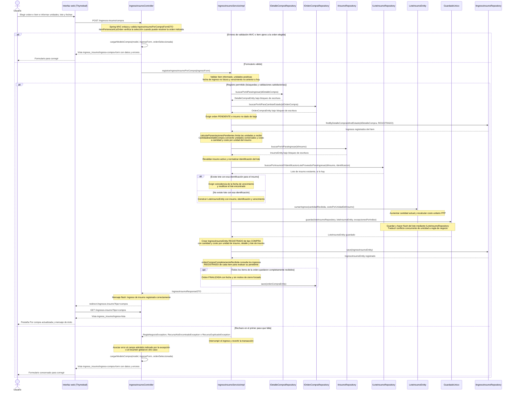

# Diagrama de secuencia de diseño: registrar ingreso de insumo por compra

El diagrama muestra cómo `IngresoInsumoController.registrarIngresoPorCompra` y `IngresoInsumoServicioImpl.registrarIngresoInsumoPorCompra` reciben un ítem de una orden de compra, actualizan el stock y su costo promedio y, cuando corresponde, finalizan la orden. Parte del formulario ya abierto, con un usuario autorizado mediante `INGRESO_INSUMO_REGISTRAR`. El ingreso directo queda fuera de este caso de uso.

## Participantes y abstracción

- **Interfaz web e IngresoInsumoController:** representan `ingreso_insumo/ingreso-compra-form.html`, la petición HTTP y el listado `ingreso_insumo/ingreso-lista.html`. El ID de la orden seleccionada viaja como parámetro auxiliar de pantalla, mientras el detalle de compra identifica la recepción en el servicio. El éxito usa Post-Redirect-Get hacia la pestaña Por compra y los errores vuelven a renderizar el formulario en la misma petición.
- **IngresoInsumoServicioImpl, IDetalleCompraRepository e IOrdenCompraRepository:** coordinan la recepción transaccional y bloquean detalle y orden para serializar ingresos y cierres concurrentes. La orden debe estar `PENDIENTE` y las unidades recibidas no pueden superar las pendientes del ítem.
- **IIngresoInsumoRepository:** aporta las recepciones registradas para calcular pendientes y guarda el ingreso `COMPRA`. Tras guardarlo, se revisan todos los ítems y se finaliza automáticamente la orden si ya no queda cantidad pendiente. Ese cierre conserva fecha y no tiene motivo de finalización forzada.
- **IInsumoRepository e ILoteInsumoRepository:** resuelven el stock por insumo e identificación de lote de proveedor, comparada sin distinguir mayúsculas. Se bloquea primero el insumo para serializar la creación o reutilización de su lote. Si el lote existe, su vencimiento debe coincidir con el informado.
- **LoteInsumoEntity:** tiene línea de vida porque su método real `sumarIngreso` aumenta existencias y recalcula el precio promedio ponderado (PPP), combinando valor y cantidad anteriores con el nuevo aporte.
- **GuardadoUnico:** encapsula la persistencia y el `flush` del lote de insumo. La restricción única conserva la garantía final y un conflicto concurrente se traduce a una regla de negocio que permite informar el rechazo.

La cantidad de compra se expresa en unidades comerciales, por ejemplo bolsas. Se convierte al contenido real en la unidad del insumo antes de sumar stock. El costo de la orden está definido por presentación y también se convierte al costo por unidad de insumo que conserva el ingreso. Esta transformación se mantiene como nota por su significado de negocio, sin detallar fórmulas.

El fragmento permitido resume el recorrido satisfactorio. Cualquier validación fallida, referencia inexistente, exceso de recepción o conflicto de vencimiento interrumpe el primer paso que falle, sin ejecutar los siguientes. La transacción revierte las escrituras previas, incluido el cambio de stock y PPP. Las fechas de ingreso y vencimiento son obligatorias y se comparan con hoy según sus reglas respectivas.

El controlador captura los rechazos del servicio, incluidos recursos no encontrados y duplicados. Los asocia al campo admitido indicado por la excepción, o al resumen global en otro caso. Las consultas de `itemPerteneceALaOrden`, `cargarModeloCompra` y del listado se encapsulan para mantener el nivel de diseño. El servicio deriva la orden real del detalle recibido y no confía en el parámetro auxiliar de pantalla.

Se omiten getters, setters, construcción de entidades, conversiones a DTO, redondeos, buscadores y consultas de presentación. No se registra un ingreso directo, consumo o reserva de insumos en este flujo. La infraestructura transversal de seguridad y auditoría y los errores técnicos quedan fuera del diagrama.

## Código de referencia

- [IngresoInsumoController.java](../../../../src/main/java/com/github/heikyudev/maestrocervecero/presentation/controller/ingreso_insumo/IngresoInsumoController.java): `registrarIngresoPorCompra`, `itemPerteneceALaOrden`, reconstrucción del formulario y manejo de errores.
- [IngresoInsumoServicioImpl.java](../../../../src/main/java/com/github/heikyudev/maestrocervecero/service/implementation/ingreso_insumo/IngresoInsumoServicioImpl.java): `registrarIngresoInsumoPorCompra`, cálculo de pendientes, resolución del lote y cierre automático de la orden.
- [LoteInsumoEntity.java](../../../../src/main/java/com/github/heikyudev/maestrocervecero/persistence/entity/ingreso_insumo/LoteInsumoEntity.java): `sumarIngreso` y actualización del PPP.
- [IDetalleCompraRepository.java](../../../../src/main/java/com/github/heikyudev/maestrocervecero/persistence/repository/orden_compra/IDetalleCompraRepository.java), [IOrdenCompraRepository.java](../../../../src/main/java/com/github/heikyudev/maestrocervecero/persistence/repository/orden_compra/IOrdenCompraRepository.java), [IInsumoRepository.java](../../../../src/main/java/com/github/heikyudev/maestrocervecero/persistence/repository/insumo/IInsumoRepository.java), [ILoteInsumoRepository.java](../../../../src/main/java/com/github/heikyudev/maestrocervecero/persistence/repository/ingreso_insumo/ILoteInsumoRepository.java) e [IIngresoInsumoRepository.java](../../../../src/main/java/com/github/heikyudev/maestrocervecero/persistence/repository/ingreso_insumo/IIngresoInsumoRepository.java): búsquedas, bloqueos y persistencia.
- [GuardadoUnico.java](../../../../src/main/java/com/github/heikyudev/maestrocervecero/util/persistencia/GuardadoUnico.java): guardado y traducción de conflictos de unicidad.
