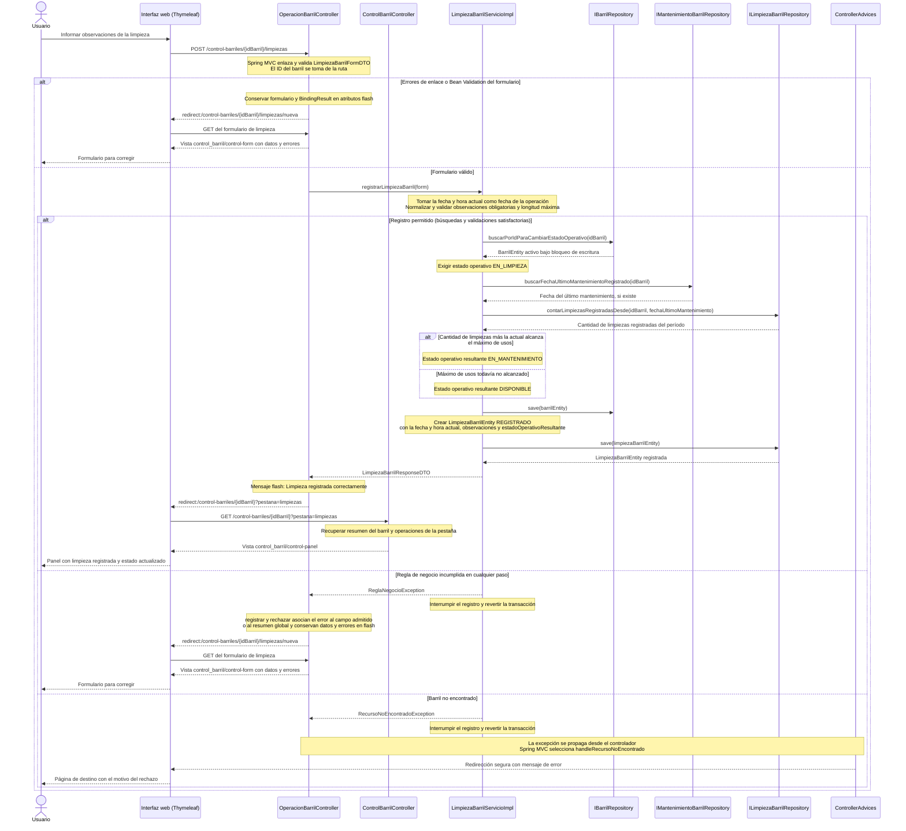

# Diagrama de secuencia de diseño: registrar limpieza de barril

El diagrama muestra cómo `OperacionBarrilController.registrarLimpieza` y `LimpiezaBarrilServicioImpl.registrarLimpiezaBarril` registran una limpieza y deciden si el barril queda disponible o requiere mantenimiento. Parte del formulario ya abierto, con un usuario autorizado mediante `LIMPIEZA_BARRIL_REGISTRAR`.

## Participantes y abstracción

- **Interfaz web, OperacionBarrilController y ControlBarrilController:** representan `control_barril/control-form.html`, el envío HTTP y el retorno mediante Post-Redirect-Get al panel `control_barril/control-panel.html`. El ID del barril procede de la ruta. El panel de resultado lo atiende un controlador distinto del que registra.
- **LimpiezaBarrilServicioImpl e IBarrilRepository:** coordinan la transacción y recuperan el barril activo bajo bloqueo. Exigen `EN_LIMPIEZA` y guardan el estado operativo resultante. Es el único bloqueo de escritura de la operación y se toma antes de consultar los usos.
- **IMantenimientoBarrilRepository e ILimpiezaBarrilRepository:** aportan el último mantenimiento y la cantidad de limpiezas registradas desde entonces. Si nunca hubo mantenimiento, se cuentan todas. Se suma la limpieza actual y, al alcanzar o superar `usosMaximosAntesMantenimiento`, el barril queda `EN_MANTENIMIENTO`. Si todavía no alcanza ese límite, queda `DISPONIBLE`.
- **ControllerAdvices:** maneja los recursos inexistentes propagados por el controlador mediante `handleRecursoNoEncontrado` y una redirección segura con error.

La limpieza conserva el `estadoOperativoResultante` que dejó en el barril. Este dato permite que una eventual anulación compruebe el resultado exacto de esa operación. Las entidades se representan como datos porque no coordinan colaboraciones significativas en este flujo.

La fecha y hora de la operación es la del momento del registro: la asigna el servicio, no se ingresa en el formulario. Las observaciones son obligatorias, se normalizan y respetan una longitud máxima. Las validaciones compartidas de `MetodosCicloVida` y los cambios de las entidades se agrupan en notas. La limpieza puede exigir mantenimiento por el límite de usos, pero no crea un registro de mantenimiento automáticamente.

El fragmento permitido presenta el recorrido satisfactorio. Cada rechazo interrumpe el primer paso que falle y revierte las escrituras del servicio. Las reglas de negocio se capturan en el controlador y se asocian al campo admitido indicado por la excepción o al resumen global. Los errores MVC y esos rechazos conservan datos y errores en flash y redirigen al formulario.

El controlador elimina del resultado de validación el error del ID del barril, porque ese identificador procede de la ruta. El GET del formulario consulta su resumen y, si el estado ya no permite registrar una limpieza, vuelve al panel con un aviso. Esas consultas de presentación quedan encapsuladas.

Se omiten getters, setters, construcción de entidades, conversiones a DTO, consultas internas del panel e infraestructura transversal de seguridad y auditoría. Este registro cambia el estado operativo sin modificar el contenido del barril ni registrar un costo. La anulación es un caso de uso independiente. Los errores técnicos quedan fuera del diagrama.

## Código de referencia

- [OperacionBarrilController.java](../../../../src/main/java/com/github/heikyudev/maestrocervecero/presentation/controller/control_barril/OperacionBarrilController.java): `registrarLimpieza`, `registrar`, `rechazar` y `mostrarFormulario`.
- [LimpiezaBarrilServicioImpl.java](../../../../src/main/java/com/github/heikyudev/maestrocervecero/service/implementation/barril/LimpiezaBarrilServicioImpl.java): `registrarLimpiezaBarril`.
- [IBarrilRepository.java](../../../../src/main/java/com/github/heikyudev/maestrocervecero/persistence/repository/barril/IBarrilRepository.java), [IMantenimientoBarrilRepository.java](../../../../src/main/java/com/github/heikyudev/maestrocervecero/persistence/repository/barril/IMantenimientoBarrilRepository.java) e [ILimpiezaBarrilRepository.java](../../../../src/main/java/com/github/heikyudev/maestrocervecero/persistence/repository/barril/ILimpiezaBarrilRepository.java): bloqueo, usos y persistencia.
- [MetodosCicloVida.java](../../../../src/main/java/com/github/heikyudev/maestrocervecero/util/method/MetodosCicloVida.java): validaciones compartidas de observaciones y barril.
- [ControlBarrilController.java](../../../../src/main/java/com/github/heikyudev/maestrocervecero/presentation/controller/control_barril/ControlBarrilController.java) y [ControllerAdvices.java](../../../../src/main/java/com/github/heikyudev/maestrocervecero/presentation/advice/ControllerAdvices.java): panel de resultado y manejo global de recursos no encontrados.
