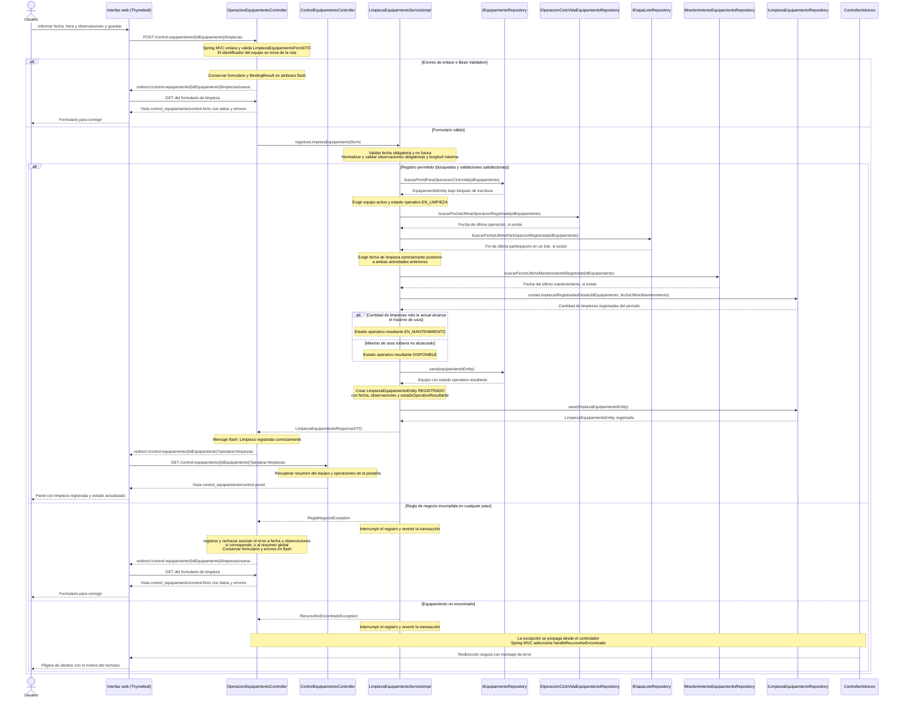

# Diagrama de secuencia de diseño: registrar limpieza de equipamiento

El diagrama muestra cómo `OperacionEquipamientoController.registrarLimpieza` y `LimpiezaEquipamientoServicioImpl.registrarLimpiezaEquipamiento` registran una limpieza y deciden si el equipo queda disponible o requiere mantenimiento. Parte del formulario ya abierto, con un usuario autorizado mediante `LIMPIEZA_EQUIPAMIENTO_REGISTRAR`.

## Participantes y abstracción

- **Interfaz web y OperacionEquipamientoController:** representan `control_equipamiento/control-form.html`, la petición HTTP y el retorno mediante Post-Redirect-Get. El ID del equipo procede de la ruta y se incorpora al formulario antes de delegar el registro. Los métodos comunes `registrar` y `rechazar` conservan los datos y errores en flash.
- **LimpiezaEquipamientoServicioImpl e IEquipamientoRepository:** coordinan la transacción y bloquean primero el equipo, antes de leer su historial o contar usos. El equipo debe existir, estar activo y encontrarse `EN_LIMPIEZA`.
- **IOperacionCicloVidaEquipamientoRepository e IEtapaLoteRepository:** aportan la última operación registrada y el fin del último uso del equipo en producción. La fecha de limpieza debe ser estrictamente posterior a ambas, además de no ser futura.
- **IMantenimientoEquipamientoRepository e ILimpiezaEquipamientoRepository:** aportan el último mantenimiento y la cantidad de limpiezas registradas desde entonces. Si nunca hubo mantenimiento, se cuentan todas. Se suma la limpieza actual y, al alcanzar o superar `usosMaximosAntesMantenimiento`, el equipo queda `EN_MANTENIMIENTO`. Si todavía no alcanza ese límite, queda `DISPONIBLE`.
- **ControllerAdvices:** maneja los recursos inexistentes que el controlador deja propagar, mediante `handleRecursoNoEncontrado` y una redirección segura con error.

La limpieza conserva el `estadoOperativoResultante` que dejó en el equipo. Este dato permite que una eventual anulación compruebe el resultado exacto de esa operación. Las entidades se representan como datos, ya que sus cambios relevantes quedan resumidos en notas.

El fragmento permitido presenta el recorrido satisfactorio. Cada rechazo interrumpe el primer paso que falle y revierte las escrituras del servicio. Las reglas de negocio se capturan en el controlador y se asocian al campo `fecha` u `observaciones` cuando la excepción lo indica, o al resumen global en otro caso. Tanto esos rechazos como los errores de validación MVC vuelven al formulario por redirección con los datos ingresados.

El GET del formulario consulta el resumen del equipo mediante `ControlEquipamientoServicioImpl.buscarResumen`. Si su estado ya no permite registrar una limpieza, vuelve al panel con un aviso en lugar de mostrar el formulario. El panel posterior al éxito lo atiende `ControlEquipamientoController`, cuya consulta se resume. Las validaciones compartidas de `MetodosCicloVidaEquipamiento` se agrupan en notas, sin una línea de vida auxiliar.

Se omiten getters, setters, construcción de entidades, conversiones a DTO y consultas de presentación. Este registro no incorpora un costo ni crea un mantenimiento automáticamente, solo puede dejar el equipo en `EN_MANTENIMIENTO`. La infraestructura transversal de seguridad y auditoría y los errores técnicos quedan fuera del diagrama.

## Código de referencia

- [OperacionEquipamientoController.java](../../../../src/main/java/com/github/heikyudev/maestrocervecero/presentation/controller/control_equipamiento/OperacionEquipamientoController.java): `registrarLimpieza`, `registrar`, `rechazar` y `mostrarFormulario`.
- [LimpiezaEquipamientoServicioImpl.java](../../../../src/main/java/com/github/heikyudev/maestrocervecero/service/implementation/equipamiento/LimpiezaEquipamientoServicioImpl.java): `registrarLimpiezaEquipamiento`.
- [MetodosCicloVidaEquipamiento.java](../../../../src/main/java/com/github/heikyudev/maestrocervecero/util/method/equipamiento/MetodosCicloVidaEquipamiento.java): reglas de fecha, observaciones, equipo activo y estado operativo.
- [IEquipamientoRepository.java](../../../../src/main/java/com/github/heikyudev/maestrocervecero/persistence/repository/equipamiento/IEquipamientoRepository.java), [IOperacionCicloVidaEquipamientoRepository.java](../../../../src/main/java/com/github/heikyudev/maestrocervecero/persistence/repository/equipamiento/IOperacionCicloVidaEquipamientoRepository.java), [IEtapaLoteRepository.java](../../../../src/main/java/com/github/heikyudev/maestrocervecero/persistence/repository/lote/IEtapaLoteRepository.java), [IMantenimientoEquipamientoRepository.java](../../../../src/main/java/com/github/heikyudev/maestrocervecero/persistence/repository/equipamiento/IMantenimientoEquipamientoRepository.java) e [ILimpiezaEquipamientoRepository.java](../../../../src/main/java/com/github/heikyudev/maestrocervecero/persistence/repository/equipamiento/ILimpiezaEquipamientoRepository.java): bloqueo, historial, usos y persistencia.
- [ControlEquipamientoController.java](../../../../src/main/java/com/github/heikyudev/maestrocervecero/presentation/controller/control_equipamiento/ControlEquipamientoController.java) y [ControllerAdvices.java](../../../../src/main/java/com/github/heikyudev/maestrocervecero/presentation/advice/ControllerAdvices.java): panel de resultado y manejo global de recursos no encontrados.
