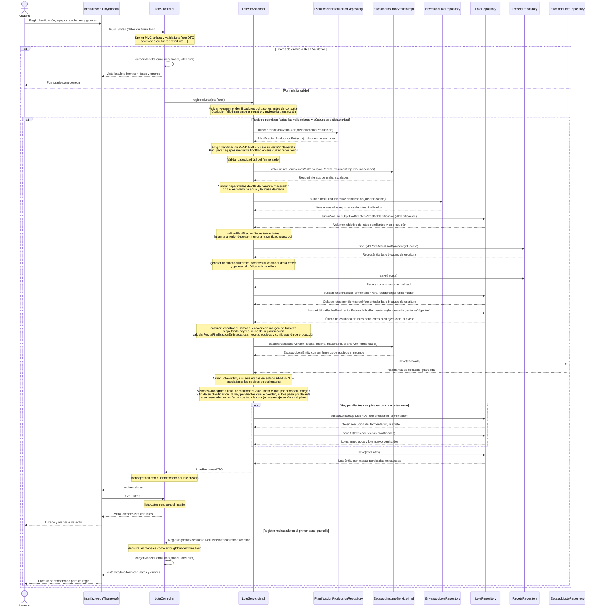

# Diagrama de secuencia de diseño: registrar lote

El diagrama muestra cómo `LoteController.registrarLote` y `LoteServicioImpl.registrarLote` colaboran para registrar un lote con su cronograma, una instantánea del escalado y seis etapas en estado `PENDIENTE`. Parte del formulario ya abierto, con un usuario autorizado mediante `LOTE_REGISTRAR`.

## Participantes y abstracción

- **Interfaz web y LoteController:** representan el envío del formulario, la validación MVC y la decisión entre volver a `lote/lote-form.html` o aplicar Post-Redirect-Get hacia `lote/lote-lista.html`. Las peticiones HTTP se distinguen de los mensajes Java.
- **LoteServicioImpl:** coordina el registro transaccional. El volumen debe ser finito y positivo después del redondeo; la planificación y los cuatro equipos son obligatorios. Se exige planificación `PENDIENTE`, capacidad suficiente del fermentador, olla y macerador, y que los lotes existentes todavía no cubran la cantidad solicitada.
- **IPlanificacionProduccionRepository e IRecetaRepository:** mantienen visibles los bloqueos pesimistas para decidir sobre una planificación y actualizar el contador de la receta. El lote usa la versión que ya tiene asociada la planificación, sin buscar la versión vigente actual.
- **IEnvasadoLoteRepository e ILoteRepository:** aportan la cobertura de producción y el cronograma del fermentador; este último también persiste el lote y sus etapas. La cobertura se evalúa **antes** de agregar el nuevo lote: esta regla no exige que su volumen quepa exactamente en la cantidad restante.
- **EscaladoInsumoServicioImpl e IEscaladoLoteRepository:** calculan la malta necesaria y capturan/persisten los parámetros de equipos e insumos. Esa instantánea evita que cambios posteriores alteren el escalado del lote registrado.

El fragmento de registro permitido presenta el recorrido exitoso completo. La alternativa de rechazo resume el fallo en cualquiera de sus pasos: una referencia inexistente genera `RecursoNoEncontradoException`; una regla incumplida genera `ReglaNegocioException`. No se ejecutan los pasos posteriores al fallo y la transacción revierte las escrituras previas. No se agrega recuperación para excepciones técnicas no capturadas por el controlador.

Para mantener legible el diseño, las búsquedas `findById` de `IMolinoRepository`, `IMaceradorRepository`, `IOllaHervorRepository` e `IFermentadorRepository`, junto con el bloqueo de escritura del fermentador previo a la suya, se resumen en una nota, en su orden real. Solo recuperan equipos activos; no se inventa un repositorio común. También se encapsulan las fórmulas de `EscaladoAgua` y la consulta `IConfiguracionProduccionRepository.findById` que aporta la velocidad de envasado al cálculo de finalización.

El inicio estimado se ubica detrás de los lotes vivos del fermentador, con margen de limpieza de dos días respecto del mayor entre su último fin y hoy, sin comenzar antes de hoy ni del inicio de la planificación. El orden de la cola lo define la planificación del lote: mayor prioridad (`ALTA`, `MEDIA`, `BAJA`) primero; a igual prioridad, menor margen (`fechaFinalizacionEstimada - fechaInicioEstimada`, en días); a igual margen, fin más temprano; y con empate total, el orden de registro. El lote queda inmediatamente después del último lote pendiente que le gana o empata (en una cola reordenada a mano se mira ese último lote, aunque haya lotes que le pierden delante de él) y por delante de los que le pierden, que se empujan hacia atrás con sus duraciones intactas. En ese caso se recalculan en la misma transacción las fechas estimadas de toda la cola pendiente del fermentador (cada lote arranca dos días después del fin del anterior, sin comenzar antes de hoy ni del inicio de su planificación). El lote en ejecución nunca se mueve y es el piso de la cola: el lote nuevo no arranca antes de dos días después de su fin estimado (desde hoy si está atrasado). El piso de la planificación manda también cuando el lote nuevo pasa por delante: si su planificación inicia en el futuro, el lote nuevo queda en la posición 0 pero arranca en ese día, y los pendientes de menor prioridad van detrás de él sin ocupar el hueco previo; del mismo modo, un lote empujado no arranca antes del inicio de su propia planificación. El reencadenado abarca toda la cola pendiente del fermentador, de modo que un pendiente con inicio estimado anterior a hoy pasa a hoy (o al primer día libre de la cadena); si el lote nuevo va al final de la cola no hay reencadenado y las fechas de los pendientes no cambian. El fermentador se bloquea para escritura antes de leer la cola, en el orden canónico planificación, fermentador y cola, para que dos registros simultáneos no se intercalen. Las seis etapas son molienda, maceración, hervido, fermentación, maduración y envasado; las tres últimas comparten fermentador. Su construcción se resume en una nota y su persistencia utiliza la cascada del lote.

Se omiten getters, setters, builders, conversiones a DTO, formato del código y la infraestructura transversal de seguridad y auditoría. `cargarModeloFormulario` encapsula las consultas de presentación que reconstruyen los textos de la planificación y los equipos seleccionados; la consulta del listado también se resume. Registrar el lote planifica su uso del fermentador: no inicia la producción ni reserva stock o cambia el estado operativo de los equipos; esas acciones corresponden a `iniciarLote`.

## Código de referencia

- [LoteController.java](../../../../src/main/java/com/github/heikyudev/maestrocervecero/presentation/controller/lote/LoteController.java): `registrarLote`, `cargarModeloFormulario` y `listarLotes`.
- [LoteServicioImpl.java](../../../../src/main/java/com/github/heikyudev/maestrocervecero/service/implementation/lote/LoteServicioImpl.java): `registrarLote` y sus métodos de validación, identificación, cronograma y creación de etapas.
- [EscaladoInsumoServicioImpl.java](../../../../src/main/java/com/github/heikyudev/maestrocervecero/service/implementation/lote/EscaladoInsumoServicioImpl.java): `calcularRequerimientosMalta` y `capturarEscalado`.
- [IPlanificacionProduccionRepository.java](../../../../src/main/java/com/github/heikyudev/maestrocervecero/persistence/repository/planificacion_produccion/IPlanificacionProduccionRepository.java) e [IRecetaRepository.java](../../../../src/main/java/com/github/heikyudev/maestrocervecero/persistence/repository/receta/IRecetaRepository.java): consultas con bloqueo de escritura.
- [ILoteRepository.java](../../../../src/main/java/com/github/heikyudev/maestrocervecero/persistence/repository/lote/ILoteRepository.java), [IEnvasadoLoteRepository.java](../../../../src/main/java/com/github/heikyudev/maestrocervecero/persistence/repository/lote/IEnvasadoLoteRepository.java) e [IEscaladoLoteRepository.java](../../../../src/main/java/com/github/heikyudev/maestrocervecero/persistence/repository/lote/IEscaladoLoteRepository.java): cobertura, cronograma y persistencia.
- [LoteEntity.java](../../../../src/main/java/com/github/heikyudev/maestrocervecero/persistence/entity/lote/LoteEntity.java): asociaciones con planificación, escalado y etapas.
