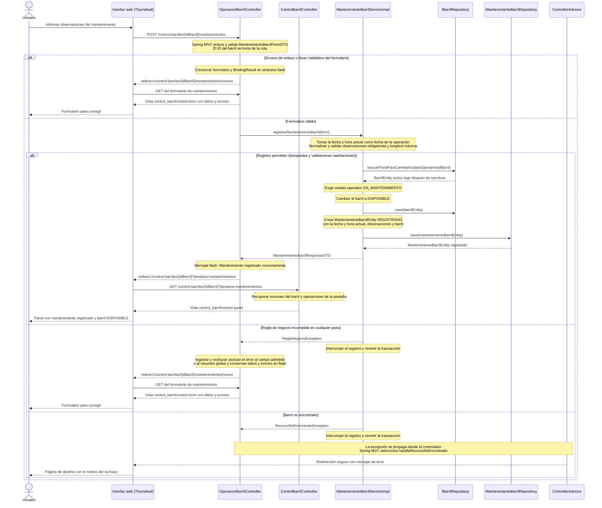

# Diagrama de secuencia de diseño: registrar mantenimiento de barril

El diagrama muestra cómo `OperacionBarrilController.registrarMantenimiento` y `MantenimientoBarrilServicioImpl.registrarMantenimientoBarril` registran un mantenimiento y devuelven el barril a disponibilidad operativa. Parte del formulario ya abierto, con un usuario autorizado mediante `MANTENIMIENTO_BARRIL_REGISTRAR`.

## Participantes y abstracción

- **Interfaz web, OperacionBarrilController y ControlBarrilController:** representan `control_barril/control-form.html`, el envío HTTP y el retorno mediante Post-Redirect-Get al panel `control_barril/control-panel.html`. El barril procede de la ruta. El panel de resultado lo atiende un controlador distinto del que registra.
- **MantenimientoBarrilServicioImpl e IBarrilRepository:** coordinan la transacción y recuperan el barril activo bajo bloqueo. Exigen `EN_MANTENIMIENTO` y guardan la transición a `DISPONIBLE`. Es el único bloqueo de escritura de la operación.
- **IMantenimientoBarrilRepository:** persiste el mantenimiento `REGISTRADO`, asociado al barril y con la fecha y hora actual y sus observaciones.
- **ControllerAdvices:** maneja los recursos inexistentes propagados por el controlador mediante `handleRecursoNoEncontrado` y una redirección segura con error.

La fecha y hora de la operación es la del momento del registro: la asigna el servicio, no se ingresa en el formulario. Las observaciones son obligatorias, se normalizan y tienen longitud máxima. Las validaciones compartidas de `MetodosCicloVida` y los cambios de las entidades se agrupan en notas. La precondición `EN_MANTENIMIENTO` expresa el ciclo operativo del barril, sin una consulta a una falla individual en este registro.

El fragmento permitido presenta el recorrido satisfactorio. Cada rechazo interrumpe el primer paso que falle y revierte las escrituras del servicio. Las reglas de negocio se capturan en el controlador y se asocian al campo admitido indicado por la excepción o al resumen global. Los errores MVC y esos rechazos conservan los datos y errores en flash y redirigen al formulario.

El controlador elimina del resultado de validación el error del ID del barril, porque ese identificador procede de la ruta. El GET del formulario consulta su resumen y, si el estado ya no permite registrar un mantenimiento, vuelve al panel con un aviso. Esas consultas de presentación quedan encapsuladas.

Las entidades se representan como datos porque no coordinan colaboraciones significativas en este flujo. Se omiten getters, setters, construcción de entidades, conversiones a DTO, consultas internas del panel e infraestructura transversal de seguridad y auditoría. Este registro cambia la disponibilidad operativa sin modificar el contenido del barril ni registrar un costo de mantenimiento. La anulación es un caso de uso independiente. Los errores técnicos quedan fuera del diagrama.

## Código de referencia

- [OperacionBarrilController.java](../../../../src/main/java/com/github/heikyudev/maestrocervecero/presentation/controller/control_barril/OperacionBarrilController.java): `registrarMantenimiento`, `registrar`, `rechazar` y `mostrarFormulario`.
- [MantenimientoBarrilServicioImpl.java](../../../../src/main/java/com/github/heikyudev/maestrocervecero/service/implementation/barril/MantenimientoBarrilServicioImpl.java): `registrarMantenimientoBarril`.
- [IBarrilRepository.java](../../../../src/main/java/com/github/heikyudev/maestrocervecero/persistence/repository/barril/IBarrilRepository.java) e [IMantenimientoBarrilRepository.java](../../../../src/main/java/com/github/heikyudev/maestrocervecero/persistence/repository/barril/IMantenimientoBarrilRepository.java): bloqueo y persistencia.
- [MetodosCicloVida.java](../../../../src/main/java/com/github/heikyudev/maestrocervecero/util/method/MetodosCicloVida.java): validaciones compartidas de observaciones y barril.
- [ControlBarrilController.java](../../../../src/main/java/com/github/heikyudev/maestrocervecero/presentation/controller/control_barril/ControlBarrilController.java) y [ControllerAdvices.java](../../../../src/main/java/com/github/heikyudev/maestrocervecero/presentation/advice/ControllerAdvices.java): panel de resultado y manejo global de recursos no encontrados.
