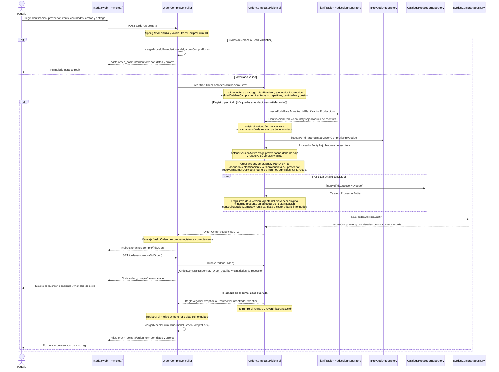

# Diagrama de secuencia de diseño: registrar orden de compra

El diagrama muestra cómo `OrdenCompraController.registrarOrdenCompra` y `OrdenCompraServicioImpl.registrarOrdenCompra` registran una orden pendiente para una planificación de producción, utilizando el catálogo vigente de un proveedor. Parte del formulario ya abierto, con un usuario autorizado como `GERENTE_DE_COMPRAS`.

## Participantes y abstracción

- **Interfaz web y OrdenCompraController:** representan `orden_compra/orden-form.html`, la petición HTTP y el detalle `orden_compra/orden-detalle.html`. El éxito utiliza Post-Redirect-Get hacia la orden creada. Los errores vuelven a renderizar el formulario en la misma petición, conservando sus datos y filas.
- **OrdenCompraServicioImpl e IPlanificacionProduccionRepository:** coordinan el registro transaccional y exigen una planificación `PENDIENTE`, recuperada bajo bloqueo. Los insumos admitidos provienen de la versión de receta asociada a esa planificación, sin buscar una receta vigente diferente.
- **IProveedorRepository:** bloquea la fila del proveedor antes de comprobar que no esté dado de baja y resolver su versión vigente. El bloqueo evita que una baja o cambio concurrente se cruce con el registro. La orden conserva la referencia a esa versión concreta.
- **ICatalogoProveedorRepository:** resuelve cada ítem solicitado. Debe pertenecer a la versión vigente seleccionada del proveedor y su insumo debe formar parte de la receta de la planificación. Un ítem ausente o no admitido interrumpe el registro antes de guardar la orden.
- **IOrdenCompraRepository:** persiste la orden `PENDIENTE` y sus `DetalleCompraEntity` mediante cascada. Las entidades se representan como datos porque no coordinan este flujo.

La fecha de entrega es obligatoria, no puede ser anterior a hoy ni superar el plazo técnico de un año. La orden exige planificación y proveedor, y debe contener entre uno y el máximo técnico de ítems, sin repetir un mismo ítem de catálogo. Cantidades y costos unitarios deben ser positivos y respetar sus límites, incluido el máximo de cuatro decimales para el costo. Estas validaciones internas se agrupan en notas.

El costo unitario se informa en esta compra y queda en su detalle: el catálogo del proveedor define qué se ofrece, no fija su precio. La orden tampoco actualiza existencias ni registra recepciones de insumos, que son operaciones posteriores.

El fragmento permitido resume el recorrido satisfactorio. La alternativa representa una interrupción en el primer paso que falle, tanto por datos inválidos como por planificación no pendiente, proveedor dado de baja, falta de versión vigente, referencia inexistente o ítem ajeno a proveedor o receta. No se ejecutan los pasos posteriores y se revierten las escrituras previas. El controlador captura las excepciones de negocio y muestra un error global, sin delegarlas al advice en este registro.

`cargarModeloFormulario` encapsula las consultas de presentación que reconstruyen las selecciones y los nombres de las filas. La búsqueda del detalle posterior al registro se conserva como colaboración, pero sus consultas internas se omiten. También se omiten getters, setters, construcción de entidades, conversiones a DTO, aritmética de importes, buscadores e infraestructura transversal de seguridad y auditoría. Los errores técnicos quedan fuera del diagrama.

## Código de referencia

- [OrdenCompraController.java](../../../../src/main/java/com/github/heikyudev/maestrocervecero/presentation/controller/orden_compra/OrdenCompraController.java): `registrarOrdenCompra`, `cargarModeloFormulario` y `mostrarDetalle`.
- [OrdenCompraServicioImpl.java](../../../../src/main/java/com/github/heikyudev/maestrocervecero/service/implementation/orden_compra/OrdenCompraServicioImpl.java): `registrarOrdenCompra`, `validarDetallesCompra`, `obtenerVersionActiva`, `resolverInsumosDeReceta` y `construirDetallesCompra`.
- [IPlanificacionProduccionRepository.java](../../../../src/main/java/com/github/heikyudev/maestrocervecero/persistence/repository/planificacion_produccion/IPlanificacionProduccionRepository.java), [IProveedorRepository.java](../../../../src/main/java/com/github/heikyudev/maestrocervecero/persistence/repository/proveedor/IProveedorRepository.java) e [ICatalogoProveedorRepository.java](../../../../src/main/java/com/github/heikyudev/maestrocervecero/persistence/repository/proveedor/ICatalogoProveedorRepository.java): planificación, proveedor y catálogo.
- [IOrdenCompraRepository.java](../../../../src/main/java/com/github/heikyudev/maestrocervecero/persistence/repository/orden_compra/IOrdenCompraRepository.java) y [OrdenCompraEntity.java](../../../../src/main/java/com/github/heikyudev/maestrocervecero/persistence/entity/orden_compra/OrdenCompraEntity.java): persistencia en cascada de la orden y sus detalles.
