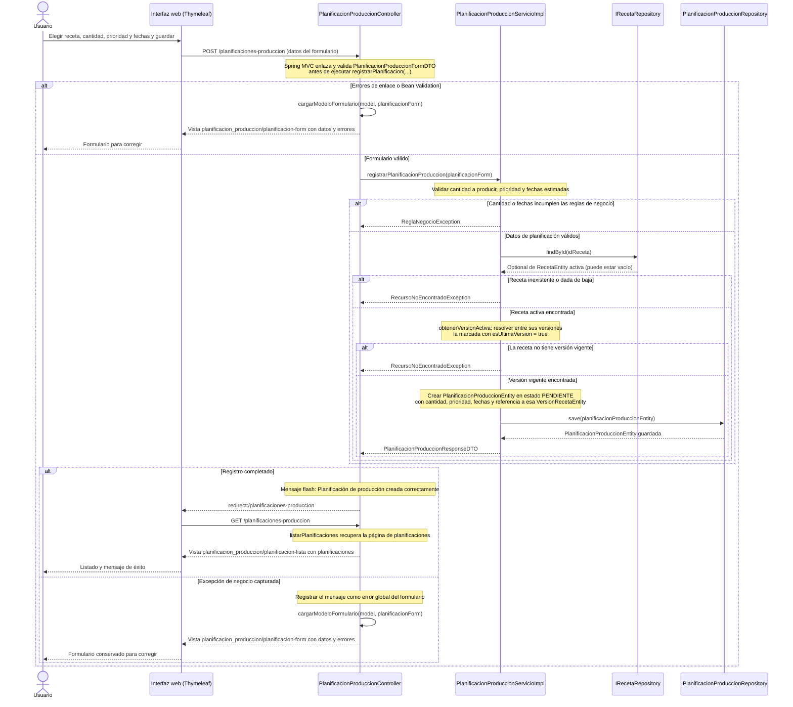

# Diagrama de secuencia de diseño: registrar planificación de producción

El diagrama muestra cómo `PlanificacionProduccionController.registrarPlanificacion` y `PlanificacionProduccionServicioImpl.registrarPlanificacionProduccion` colaboran para registrar una planificación en estado `PENDIENTE`, asociada a la versión vigente de la receta elegida. Parte del envío del formulario ya abierto, con un usuario autorizado como `GERENTE_DE_PRODUCCION`.

## Participantes y abstracción

- **Interfaz web:** representación conceptual del navegador y las plantillas reales `planificacion_produccion/planificacion-form.html` y `planificacion_produccion/planificacion-lista.html`. Las peticiones HTTP se distinguen de los métodos Java y de los resultados MVC.
- **PlanificacionProduccionController:** recibe el formulario validado, delega el registro y decide entre volver al formulario con errores o aplicar Post-Redirect-Get.
- **PlanificacionProduccionServicioImpl:** coordina las reglas del registro y la selección de la versión vigente. La cantidad debe ser finita, positiva y no superar el máximo técnico; la prioridad (`BAJA`, `MEDIA` o `ALTA`) es obligatoria y queda fija porque la planificación no se modifica después de registrada; ambas fechas son obligatorias, el inicio no puede ser anterior a hoy, el fin no puede preceder al inicio y el intervalo no puede superar 1.825 días. Estas comprobaciones se agrupan en una nota porque no son colaboraciones entre componentes.
- **IRecetaRepository:** busca únicamente recetas activas mediante `findById`. El servicio resuelve su versión vigente con el método real `obtenerVersionActiva`, que utiliza `MetodosVersionado` sobre las versiones de la receta. Ese helper se encapsula para mantener el nivel de diseño.
- **IPlanificacionProduccionRepository:** persiste la nueva planificación dentro de la transacción del servicio. Las entidades y DTO se representan como datos, sin líneas de vida propias, porque no coordinan este flujo.

La planificación conserva una referencia a la **versión concreta** elegida al registrarla: una modificación posterior de la receta no cambia esa asociación. El usuario selecciona la receta, no una versión. Este registro no crea lotes: esa funcionalidad queda fuera del flujo representado.

Se omiten getters, setters, builders, conversión a DTO y la infraestructura transversal de seguridad y auditoría (`@AuditableAction`). `cargarModeloFormulario` encapsula la recuperación del nombre de la receta seleccionada mediante `recetaServicio.buscarPorId`, cuando hay un ID, y la preparación de la URL de cancelación. La consulta del listado tras la redirección también se resume. Las alternativas cubren las excepciones capturadas por este controlador, sin inventar recuperación de fallos técnicos no capturados.

## Código de referencia

- [PlanificacionProduccionController.java](../../../../src/main/java/com/github/heikyudev/maestrocervecero/presentation/controller/planificacion_produccion/PlanificacionProduccionController.java): `registrarPlanificacion`, `cargarModeloFormulario` y `listarPlanificaciones`.
- [PlanificacionProduccionServicioImpl.java](../../../../src/main/java/com/github/heikyudev/maestrocervecero/service/implementation/planificacion_produccion/PlanificacionProduccionServicioImpl.java): `registrarPlanificacionProduccion` y `obtenerVersionActiva`.
- [IRecetaRepository.java](../../../../src/main/java/com/github/heikyudev/maestrocervecero/persistence/repository/receta/IRecetaRepository.java) e [IPlanificacionProduccionRepository.java](../../../../src/main/java/com/github/heikyudev/maestrocervecero/persistence/repository/planificacion_produccion/IPlanificacionProduccionRepository.java): consulta de recetas activas y persistencia de planificaciones.
- [MetodosVersionado.java](../../../../src/main/java/com/github/heikyudev/maestrocervecero/util/method/MetodosVersionado.java): resolución de la versión vigente.
- [PlanificacionProduccionEntity.java](../../../../src/main/java/com/github/heikyudev/maestrocervecero/persistence/entity/planificacion_produccion/PlanificacionProduccionEntity.java): asociación con una versión específica de receta.
